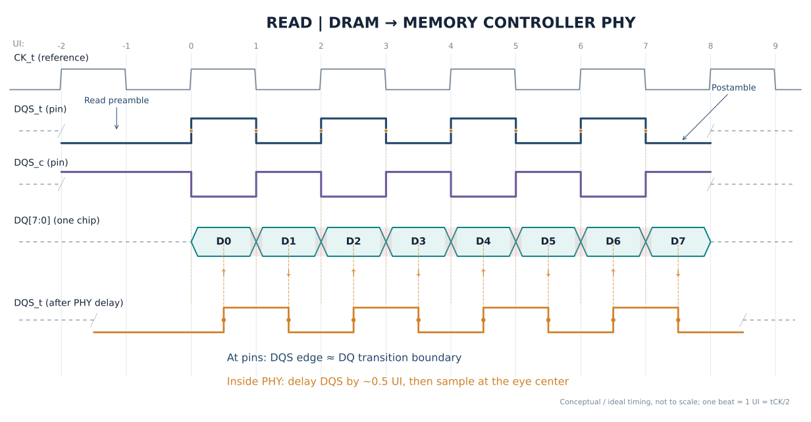
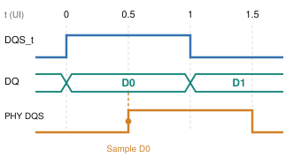
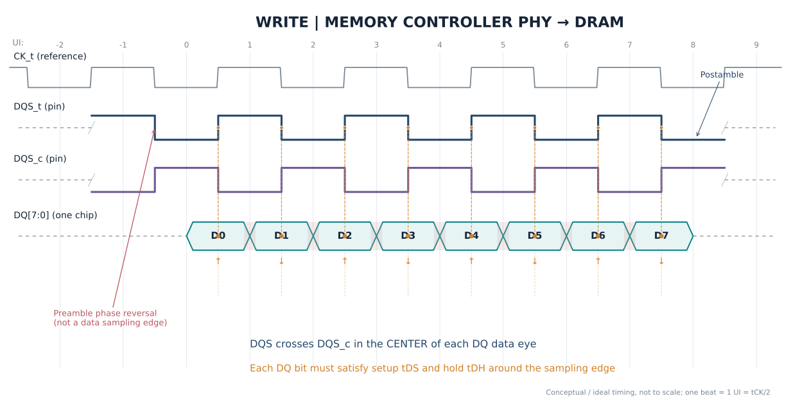
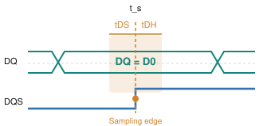
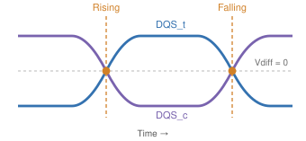

# DRAM Structure Organization

## I. Introduction

从软件看来，Memory 是一个类似：

```text
Memory[0]
Memory[1]
Memory[2]
...
```

的一维线性空间。但真实 DRAM 更接近：

```text
Channel
 └── DIMM
      └── Rank
           └── Chip
                └── Bank
                     └── Row
                          └── Column
```

也就是说，我们在 CPU 那里看到的：`PA=0x12345678`，最终可能被映射成：

```text
Channel = 1
Rank    = 0
Bank    = 5
Row     = 0x1234
Column  = 0x38
```

所以软件空间地址与物理 DRAM 地址之间存在 Address Mapping。

接下来，我们从最底层的 DRAM Cell 开始，逐步向上分析 DRAM 的层次结构。

## II. DRAM 的层次结构

### 2.1 DRAM Cell

一个 DRAM bit 的经典结构是：1 Transistor + 1 Capacitor，如图：


Capacitor 是否存储电荷表示 `1` 或 `0`。

电容会漏电，因此**需要定期 Refresh（刷新）**——这就是 DRAM 名称中 **Dynamic** 的来源之一。

### 2.2 按 Row 和 Column 的组织

假设有一大片 DRAM Cell: 

```
          Column
       0 1 2 3 4 ...
Row 0  □ □ □ □ □
Row 1  □ □ □ □ □
Row 2  □ □ □ □ □
Row 3  □ □ □ □ □
...
```

它不是每次只访问一个 bit，实际访问过程可以粗略理解为：

1. 先选一整行 Row
2. 整行数据进入 Sense Amplifier / Row Buffer
3. 再从 Row Buffer 中选择 Column

之所以会有这样的访问方式，是因为 DRAM Cell 的 Row & Column 组织方式：

DRAM Cell 的 **Word Line (字线)** 与 **Row (行)** 对应，**Bit Line (位线)** 与 **Column (列)** 对应。具体来说：

#### Word line 与 Row

Word Line 是横向贯穿存储阵列的控制线，**每一根 Word Line 唯一对应一个 Row**。

- **物理连接**：同一个 Row 上所有 DRAM Cell 的 **访问晶体管栅极（Gate）** 都连接到同一根 Word Line。当这根 Word Line 被 **激活（施加高电压）** 时，该行上所有 Cell 的晶体管会同时导通。
- **操作粒度**：DRAM 的激活操作是**以 Row 为单位**的。**Row Decoder** 根据行地址选中并驱动一根 Word Line，从而j激活整行。

正因为一根 Word Line 能一次性激活一整行的所有存储单元，所以“共享同一根 Word Line 的 Cell 集合”就被定义为一个 **DRAM Row**。

#### Bit Line 与 Column

Bit Line 是纵向贯穿存储阵列的数据线，**每一根（或每一对）Bit Line 唯一对应一个 Column**。

- **物理连接**：同一个 Column 上所有 DRAM Cell 的**访问晶体管漏极（Drain）**都连接到同一根 Bit Line。当某行的 Word Line 激活后，栅极处于高电平，晶体管导通，该行 Cell 内的电容电荷就会与各自所在列的 Bit Line 发生**电荷共享**，从而被读出。
- **数据通路**：Bit Line 负责将存储电容中的微弱信号送往**灵敏放大器（Sense Amplifier）**进行放大，最终输出为数字 0 或 1。
- **列选择**：虽然激活是整行发生的，但数据输出时，**Column Decoder** 会通过**列选择信号（CSL）**，从被激活的整行中，仅**选中所需要的那一列（或几列）**的 Bit Line 数据送到 I/O 总线上。

> 在现代 DRAM 的层次化结构中，为了降低功耗和延迟，上述“Word Line 对 Row、Bit Line 对 Column”的关系在子阵列（Subarray）层面依然严格成立，只是命名上可能演化为 **Local Word Line / Local Bit Line** 等变体。

所以 DRAM 访问天然具有**两阶段性质**：**Active Row → Access Column**。

并且，我们不难注意到上述访问方式有一个**严重限制**：**不能同时激活多行**！

!!! Warning "不能同时激活多行"
    一列的所有 DRAM Cell 是共享同一根 bit line 的吗？如果是这样，那么**一次访问开启多行的时候，然后读取同一列的数据？是否会出现错乱？还是说不允许这种操作？**

    ——没错，就是不允许这种操作！这确实是 DRAM 架构中一个关键的限制。**一列的所有 DRAM Cell 确实共享同一根 Bit Line，但同时激活多行并读取同一列是绝对不允许的**，这会直接导致数据错乱。

    在同一个 DRAM Bank 内，每一列只有一根（或一对差分）Bit Line，垂直贯穿整个阵列，连接着该列上所有 Row 的 DRAM Cell。当一行被激活时，该行所有 Cell 的电荷会同时“共享”到各自连接的 Bit Line 上，这个过程称为 **Charge Sharing**。**Sense Amplifier** 随即检测 **Bit Line 上微小的电压变化**，并将其**放大**为完整的逻辑电平。

    如果尝试在同一 Bank 中同时激活两行，那么这两行位于同一列的 Cell 会**同时向同一根 Bit Line 放电**——Bit Line 上的最终电压将取决于两个 DRAM Cell 电荷的“竞争”结果。
                        
    - 如果两个 Cell 存储的值相同（都是 1 或都是 0），Bit Line 的电压可能勉强能被正确识别；
    - 但如果一个存 1、一个存 0，它们会相互中和，导致 Bit Line 的电压处于一个模糊的中间态。**灵敏放大器无法判断这个中间电压代表的是 0 还是 1，读出的数据就是随机的、错误的**。     

    正因为这种物理上的冲突，**DRAM 的基本协议从架构上就禁止这种操作**。

!!! Attention "Precharge 与访问完整物理流程"
    从外部看，“行激活”只是给Word Line（字线）一个高电平，但在器件物理层面，这个高电平是一系列精密物理过程的触发器。而 **Precharge（预充电）** 正是为这个触发过程搭建一个确定、可复现的初始物理状态。

    我们考虑如下这一场景：存储电容为 $C_s$，**行激活前**电压 $V_{\text{cell}}$; 位线电容为 $C_{BL}$，**行激活前**电压：$V_{BL}$。我们假设晶体管是理想晶体管，导通电阻为 0，那么**行激活后**，两个电容达到相同电压：

    $$V=\frac{C_{s}V_{\text{cell}}+C_{BL}V_{\text{pre}}}{C_{s}+C_{BL}}$$

    那么位线电容的电压变化为：

    $$\Delta V_{BL}=\frac{V_{\text{cell}}-V_{\text{pre}}}{1+C_{BL}/C_{s}}$$

    通常来说，位线电容 $C_{BL}$ 远大于存储电容 $C_s$，所以 $\Delta V_{BL}$ 会相对较小。这个电压变化极其微弱，**通常只有几十到一百多毫伏**。这就是为什么单纯的“高电平”远远不够，必须要有后续的 **Sense Amplifier** 来将这个微小差异放大成完整的逻辑电平。

    **Precharge** 的核心目的，就是为上述微弱的电荷共享过程，创造一个确定、均匀且已知的**初始条件**。**简单来说，就是提供一个稳定的、确定的 $V_{\text{BL}}$**。如果没有Precharge，位线电压将处于不可预测的浮动状态，**微弱的信号将完全被噪声淹没**。

    **Precharge 的物理过程**可以总结为：通过 Precharge电路，将**一对互补位线（BL和/BL）短接**，使它们的**电位强制相等**，通常为：$V_{DD}/2$，这是一个**精妙的平衡**。无论电容存储的是**高电平（接近 $V_{DD}$）**还是**低电平（接近0V）**，电荷共享后，位线电压都会从 $V_{DD}/2$ 这个“中点”**向两个方向产生对称的偏移**。这能**最大化灵敏放大器可检测的初始电压差**。

    结合上述物理过程，一次DRAM读取在器件层面的完整图景是：

    1.  **Precharge**：位线对（BL, /BL）被均衡并预充到 $V_{DD}/2$。此时，字线处于关闭状态，存储电容 $C_S$ **与外界隔离**，保持着数据电荷。
    2.  **行激活与电荷共享**：字线被拉至高电平，该行所有存取晶体管导通。每个存储电容 $C_S$ 与自己的位线 $C_{BL}$ 发生**电荷共享**，导致位线电压产生一个微小的、依赖存储数据的偏移（高于或低于$V_{DD}/2$）。
    3.  **灵敏放大**：灵敏放大器被激活，它本质上是一个**正反馈锁存器**。它检测到BL和/BL之间微小的电压差，通过正反馈迅速将这个差异**放大并锁存**：电压稍高的一侧被拉至 $V_{DD}$，稍低的一侧被拉至地（GND）。
    4.  **数据再生**：在灵敏放大过程中，被拉至满幅（$V_{DD}$或GND）的位线电压会**反过来给存储电容$C_S$充电或放电**，将其**电荷状态恢复到读取前的水平，补偿了电荷共享造成的损失**。这正是DRAM“破坏性读出”后“再生”的物理机制。


#### Row Buffer

假设 Bank 中存在 `Row 100`, `Row 101`, `Row 102` ...

当前已经打开 `Row 100`，它的数据已经被放入 **row buffer**。

这时访问 `Row 100, Column 10`，然后又访问 `Row 100, Column 20`，**第二次访问就相对快**。这称为：**Row Hit**。因为当前需要的 row 已经是 **open row**。

如果访问 `Row 101`，那么通常需要：

> *关闭 Row 100 → **Precharge** → Activate Row 101 → Access Column*

这种情况称为：**Row Conflict**。

所以 Row Hit 通常明显快于 Row Miss / Row Conflict，这也是为什么 DRAM **访问延迟并不是一个完全固定的数字**。

### 2.3 Bank

上述 Row 和 Column 的组织方式决定了一块区域不能同时激活多个 Row，否则会出现 bit line 紊乱。

如果整个 DRAM 只有一个大 Row Buffer，那么就会出现这种情况

> Access Row A → Waiting →
> Access Row B → Waiting →
> Access Row C → Waiting ...

**并行性非常差**，所以 DRAM 被进一步划分成多个 **Bank**。

例如：

```
DRAM
 ├── Bank 0
 ├── Bank 1
 ├── Bank 2
 ├── Bank 3
 ├── Bank 4
 ├── Bank 5
 ├── Bank 6
 └── Bank 7
```

每个 Bank 有自己的 Row Buffer。因此可以做到：

- Bank 0 正在 activate
- Bank 1 正在传输数据
- Bank 2 正在 **precharge**
- Bank 3 正在等待

这就是：**Bank 级并行（Bank-Level Parallelism, BLP）**


!!! Note "Latency 与 Bandwidth"
    Bank 数量增加，**并不意味着单次访问延迟变短**。它主要提高并行处理多个 memory requests 的能力。也即 **Latency 和 Bandwidth** 的区别。
    多 Bank、多 Channel 主要是在提高带宽。
    假设一个 memory request：`load A` 需要 80ns。

    如果只能串行：`Access A -> Access B -> Access B`，吞吐量会很低。

    但是如果存在多个 Bank，就可以：

    - Bank 0: Access A
    - Bank 1: Access B
    - Bank 2: Access C
                        
    很多访问就可以 overlap，于是**单次 latency 依旧很高，但是总 Throughput 会提高**。

### 2.4 DRAM Chip

一个 DRAM Chip 通常包含多个 Bank，每个 Bank 有自己的 Row Buffer 和 Column 结构。

所以到目前为止的层次化结构为：`chip -> bank -> row -> column`。

但是**一个 DRAM Chip 并不一定一次提供完整的 64 bit CPU memory bus 数据**。

例如很多 DRAM 芯片可能是：`x4`, `x8`, `x16` ... 这里的 `x8` 表示一个 DRAM Chip **每次提供 8 bit 数据**。

更具体来说，x$n$ DRAM Chip 内部阵列中，一个 Column 地址就包含 **n 个 bit**。例如：

| 芯片规格 | 每个 Column 地址对应的数据位宽 | 一个 Bank 的内部组织示例 (行 × 列 × 位宽) |
| --- | --- | --- |
| x4 | 4 bit | 4096 行 × 2048 列 **× 4 bit** |
| x8 | 8 bit | 4096 行 × 1024 列 **× 8 bit** |
| x16 | 16 bit | 4096 行 × 512 列 **× 16 bit** |


于是需要多个 DRAM chip 并行工作，例如 8 × `x8` chips 可以形成 64-bit 的数据宽度。

### 2.5 Rank

**上述共同工作的**、**一次给出完整数据**的多个 DRAM chips 称为一个 **Rank**。

概念上：

```
Rank 0
Chip0 Chip1 Chip2 Chip3 Chip4 Chip5 Chip6 Chip7
  │     │     │     │     │     │     │     │
  └─────┴─────┴─────┴─────┴─────┴─────┴─────┘
                  64-bit
```

因此 **Rank 是一组同时响应同一组 memory command、共同提供一个完整数据宽度的 DRAM chips**。

!!! Question "x8 的 8bit 来自几个 Bank、来自几个 ROW？"
    比如 CPU load A 想要一个 64 bit 的数据，那么其中分配给 DRAM chip 0 的是 A[0:7]，那么：

    1. 这 8 个 bit 是**由多个 Bank 给出的还是一个 Bank 给出的**？
    2. 如果是一个 Bank ，那么**是一个 Row 同时给出 8bit 还是多个 Row 共同给出 8bit**？

    结论是：对于一次64位的 CPU Load，分配给单个 x8 DRAM 芯片的那 8 位数据，**通常来自该芯片内部的一个Bank**，并且是在**一次行激活**后，从同一行中通过**突发传输（Burst）连续**读出的。

    更具体地来说：

    在现代 DRAM 中，一个Bank内部**一次列访问**产生的数据量**通常是64位（或128位）**。例如 x8 芯片对外的**数据引脚（DQ）是 8 位宽**，但其**内部存储阵列（Bank）到 I/O 逻辑的数据通路**要宽得多（64 bit）。
    这种设计被称为 **8n 预取架构**。以 DDR3 x8 为例，芯片内部一次性从存储阵列中**并行读出 64 位数据**，然后通过一个**多路复用器**，将这64位数据**拆分成8个连续的8位块**，在外部时钟的驱动下，通过**8 根 DQ 引脚依次串行输出**。

### 2.6 DIMM

DIMM, Dual In-line Memory Module，双列直插内存模块。是一种**将多个 DRAM chips 安装在 PCB 上，并带有金手指接口的内存模块**。一个 DIMM 可以有多个 Rank，例如：

- DIMM
    - Rank 0
    - Rank 1

物理上，DIMM 包含：

```
DIMM
 ├── DRAM Chips
 ├── SPD EEPROM
 ├── PCB
 └── 其他电气结构
```

其本质就是把多颗 DRAM 芯片组织成标准化内存模块。

### 2.7 Channel

现在来到了 Memory Controller 级别，一个 Memory Controller 可以有多个 Memory Channel，每个 Channel 通常拥有相对独立的数据传输资源。

```
Memory Controller

Channel 0 ── DIMM
Channel 1 ── DIMM
Channel 2 ── DIMM
Channel 3 ── DIMM
```

多个 Channel 可以并行工作，例如：

- Channel 0: Access A
- Channel 1: Access B
- Channel 2: Access C
- Channel 3: Access D

这就是**通道级并行（Channel-Level Parallelism, CLP）**。


## III. Memory Controller

Memory Controller (MC) 是 CPU 与 DRAM 之间的核心枢纽，它负责将 CPU 发出的**64位物理地址**翻译成 DRAM 能理解的 **Channel → Rank → Bank → Row → Column** 命令序列，并高效地调度这些命令。

Memory Controller 的主要功能包括：

1. **地址解码**：MC 内部有可编程的地址映射逻辑，负责将统一的物理地址空间“切分”成不同的位段，分别对应 Channel、Rank、Bank、Row 和 Column。
2. **命令调度与重排序**：MC 维护一个**命令队列 (Command Queue)**，它会根据 DRAM 的时序约束（如 tRAS, tRP, tCAS 等）和当前 Bank 状态（Row Buffer 是否命中），对读写请求进行**重排序 (Re-ordering)**，以最大化吞吐量、最小化延迟。
3. **刷新管理**：DRAM 电容会漏电，MC 内的**刷新逻辑** 会周期性地生成自动刷新命令，在后台维持数据完整性，无需 CPU 干预。
4. **多核仲裁**：当多个 CPU 核心同时请求内存时，MC 中的**仲裁器 (Arbiter)** 负责在命令队列和刷新逻辑之间进行选择，公平且高效地分配内存带宽。

这里我们着重介绍**物理地址解码功能**。

### 3.1 物理地址解码

物理地址解码是将一个 64 位的线性地址，按照**从低位到高位**的顺序，切分成若干段，每一段对应 DRAM 层次结构中的一个特定组件。

一个典型的解码层次结构如下（从低位到高位）：

**Byte Offset → Column → Bank (Group) → Rank → Row**

*   **Byte Offset (字节偏移)**：地址的最低几位用于在**一个数据总线宽度**（如64位=8字节）内定位具体字节。对于64位总线，最低 **3 位**（$2^3=8$）就是字节偏移。
*   **Column (列地址)**：Column 地址选择 Bank 内的列。列地址位宽决定了**每个 Row 中有多少个可寻址的“数据块”**。**而一个 Column 包含多少位数据，取决于 DRAM Chip 的规格（x4, x8, x16 等）**。例如，x8 芯片的每个 Column 地址对应 8 位数据。
    
    > 注意：这里的 Column 地址是系统地址编码中的 Column 地址，一个 Column 包含多个 bit；这个 Column 地址**不是 DRAM Chip 内部 Cell Array 的 Column 地址——这个地址准确来说是 Bit Line 地址**。

*   **Bank (Bank 地址)**：Bank 地址位用于在 Rank 内选择具体的 Bank。其位宽由 Rank 内 Bank 的数量决定（例如，8 个 Bank需要 **3 位**）。
*   **Rank (Rank 地址)**：如果系统有多个 Rank，还需要一段地址来选择目标 Rank。
*   **Row (行地址)**：剩余的最高位地址段用于选择 Bank 内的 Row（页面）。这是地址中**位宽最宽**的部分，决定了每个 Bank 有多少行。

> **注意**：这个切分顺序并非绝对固定。**Column 地址有时会被拆分成高、低两部分，分别放在 Bank 地址的两侧**，以实现更精细的交错策略。

!!! Question "为什么地址解码中，没有 DRAM Chip 层级？"
    因为**同一个 Rank 内的所有 DRAM Chip 是并行、同时被选中**的—— Rank，本身就是一组 DRAM Chip。

    例如，**8 颗 x8 DRAM Chip 组成一个 64-bit Rank**。

    当 CPU 请求一个 64 位数据时：

    1. **命令与地址广播**：内存控制器向这个 Rank 发出**同一套** Command、Bank Address、Row Address、Column Address 信号。这 8 颗 Chip 的**地址引脚是并联**的，它们**同时收到完全相同的地址**。
    2. **同时激活**：8 颗 Chip 各自**在自己的对应 Bank 中激活对应的 Row**，同时进行电荷共享和灵敏放大。
    3. **各贡献 8 位**：每颗 Chip 通过自己的 8 根 DQ 引脚输出 8 位数据。
    4. **硬连线拼接**：在 PCB 或 DIMM 上，Chip 0 的 8 根 DQ 连接到数据总线的 **DQ[7:0]**，Chip 1 连接到 **DQ[15:8]**，……，Chip 7 连接到 **DQ[63:56]**。这个映射是**物理布线固定死的，不需要任何地址位来“选择”哪颗 Chip 输出哪一段**。

    所以，**Chip 之间的分工是由数据总线的物理走线决定的，而不是由地址解码决定的**。地址解码只负责在 **Channel、Rank、Bank、Row、Column** 这些维度上做选择；一旦 Rank 被选中，Rank 内所有 Chip 就作为一个整体同时工作。

!!! Question "Channel 层级为什么通常不会放在地址最高位？"
    这是体系结构中一个很漂亮的设计思想。
    假设：

    - `0x00000000` ~ `0x3FFFFFFF` → Channel 0
    - `0x40000000` ~ `0x7FFFFFFF` → Channel 1
                
    那么连续数组：`A[0], A[1], A[2], A[3]...` 它们的 PA 的高位地址通常是相同的，因此 CPU 很可能长期只访问：Channel 0，**这会浪费其他并行 Channel 的带宽**。

    因此 Memory Controller 通常会做：**Memory Interleaving**，将连续的地址**映射到不同的 Channel** 上，从而**充分利用多通道并行性**。

#### 地址映射的灵活性与交错策略

上面的例子展示的是一种**物理布局**。但在真实系统中，MC 的地址映射是**高度可配置**的，其核心目的是优化**并行性**。这通过**交错 (Interleaving)** 技术实现：

* **Channel Interleaving**：例如上述例子。
*   **Cache-line Interleaving**：将连续的 Cache Line 分散到**不同的 Bank** 中。这样，CPU 连续访问相邻地址时，请求**会并行地发往多个 Bank**，从而隐藏单个 Bank 的**行激活延迟**，提升带宽。
*   **Row Interleaving**：将连续的地址映射到**不同的 Bank 的相同 Row** 中，这同样是为了并行化访问。

此外，现代 MC 还会使用**XOR 加密/散列**的方式，将部分高位地址位（如 Row 位）与低位地址位（如 Bank 位）进行异或运算，来生成最终的 Bank 地址。这可以**打散**规律性的访问模式，避免“Bank 冲突”（多个请求同时命中同一个 Bank），是一种更高级的交错技术。

### 3.2 请求调度

MC 不会严格按照 Memory 访问请求的到来顺序进行处理，而是会考虑 Re-ordering。

例如 CPU 依次发出如下访问请求：

- Req A → Bank0 Row10
- Req B → Bank0 Row10
- Req C → Bank0 Row11
- Req D → Bank0 Row10

如果严格按照顺序处理，那么：A 和 B 会开启 Row 10，但是 C **会关闭 Row 10，开启 Row 11**，这又会涉及到 Precharge → Activate → Access Column 的完整流程，**延迟会很高**。Memory Controller 完全可以重排序为：

- Req A → Bank0 Row10
- Req B → Bank0 Row10
- Req D → Bank0 Row10
- Req C → Bank0 Row11

这样就可以增加：**row buffer hit rate**，掩盖 **row activation latency**，提高吞吐量。

一个经典的调度策略就是 **FR-FCFS（First Ready - First Come First Serve）**，粗略理解是：

- 优先选择**已经 Ready** 的 Row hit
- 其次再考虑**到达时间**

这样可能可以提高这样提高 memory throughput，代价是可能带来 fairness 的问题，例如某些 Bank 的请求**可能会被长期延迟**。

## IV. MishMash

### 4.1 "$k$n" Prefetch Architecture

之前提到过这个案例：

> 以 DDR3 x8 为例，芯片内部一次性从存储阵列中**并行读出 64 位数据**，然后通过一个**多路复用器**，将这64位数据**拆分成8个连续的8位块**，在外部时钟的驱动下，通过**8 根 DQ 引脚依次串行输出**。

这种机制就是 "8n" Prefetch Architecture。

准确来说，

- $n$ = 这颗 DRAM 芯片**对外的数据引脚宽度（DQ 位宽）**。也就是的 x4、x8、x16 里的那个数字。x8 芯片，n=8；x4 芯片，n=4；x16 芯片，n=16。
- $k$ = **预取倍数**，即芯片内部一次从存储阵列中并行读出的数据量，**是外部 DQ 宽度的 $k$ 倍**。

所以“8n 预取” = 芯片内部一次并行读出 $8\times n$ 位，然后**通过 n 根 DQ 引脚分 8 拍串行送出**。

> ——这里还**必须配合 Burst 传输理解**，比如此处 Burst Length 就是 8。

不同规格 DRAM Chip 的 "8n prefetch" 体现：

| 芯片规格 | n（外部DQ宽度） | 8n（内部一次预取宽度） | 外部突发拍数 | 一次突发总输出 |
| :--- | :--- | :--- | :--- | :--- |
| x4 | 4 bit | **32 bit** | 8 拍 | 8×4 = 32 bit |
| x8 | 8 bit | **64 bit** | 8 拍 | 8×8 = 64 bit |
| x16 | 16 bit | **128 bit** | 8 拍 | 8×16 = 128 bit |

#### 硬件支持：内部数据通路

以 "x8" 的 "8n prefetch" 为例，一颗 x8 芯片内部的数据流是这样的：

{layout="tala", width="60%"}


- **暂存**：8n 预取并行读出的宽数据（例如 64 位），会被送入位于 **Sense Amplifier 和 Column Selector** 之间的 Latch 或 Register阵列中。这个寄存器阵列**有能力存储一次突发传输所需的全部数据**。
- **输出过程**：这个宽寄存器阵列的输出连接到一个多路复用器。MUX 在内部高速时钟的驱动下，逐拍从宽数据中**切出 n 位**，送往 DQ 引脚。这就完成了并行到串行的转换。

#### 设计动机：为什么要有 prefetch

——**解决“核心慢、接口快”的速度鸿沟**，这是 prefetch architecture 存在的根本原因。

DRAM 的**核心阵列**（电容 + 灵敏放大器 + 位线）的物理操作速度是有上限的——灵敏放大器检测微小电压差、电荷共享、数据再生，这些**模拟物理过程需要时间**。而**外部 I/O 接口**的时钟频率**却在每一代 DDR 中不断飙升**。

如果内部阵列和外部接口以同样的速率、同样的宽度工作，那么接口频率一提速，核心阵列就跟不上了。

**$k$n prefetch** 的精妙之处在于：**让内部阵列以外部接口 $1/k$ 的频率工作，但每次多读 $k$ 倍的数据**。

核心阵列不必跑得和接口一样快，只要一次多读一点、**把数据“囤”在 MUX 前面**，就能跟上外部的高速串行输出。

### 4.2 Burst 传输

Burst 传输是一种 DRAM 操作模式：在**接收到一个起始地址和读/写命令**后，DRAM 芯片会**自动地、连续地**访问一系列**相邻的列地址**，并连续地输出或输入**多个数据字**，而无需 Memory Controller 为每个数据字都发送单独的列地址命令。

Burst 传输的几个关键特性：

- **突发长度（Burst Length, BL）**：一次突发传输包含的数据“拍”数。对于 64 位总线，**BL=8** 是DDR3/DDR4时代的标准配置，正好对应一个 64 字节的 Cache Line。
- **突发类型（Burst Type）**：数据输出的顺序。可以是**顺序**的（如 0-1-2-3-4-5-6-7），也可以是**交错（Interleaved）** 的（如 0-1-2-3-4-5-6-7 的一种混淆顺序）。
- **环绕（Wrap）特性**：突发传输会在一个对齐的地址块边界内“环绕”。例如，考虑如下案例：
    
    **64 位**系统，单 Channel，单 Rank，8 个 x8 DRAM chip，默认 Burst Length = 8
    该系统中，因为是 x8，因此**系统地址编码中的 Column 地址**，一个地址就对应 Cell Array 中的 **8bit 数据**；8 个 x8 DRAM Chip 的这 8 bit 数据**共同组成一个完整的 64 bit 字**。

    现在，我们假设系统地址给出的 Column 地址是 5，而 Burst Length = 8，那么此时的访问顺序就是：“字5→字6→字7→字0→字1→字2→字3→字4”，具体来说：

    - 第一次：8 个 x8 DRAM Chip 各自给出 Column 5 的 8 bit 数据，组成完整的 64 bit，对应“**字5**”。
    - 第二次：8 个 x8 DRAM Chip 各自给出 Column 6 的 8 bit 数据，组成完整的 64 bit，对应“**字6**”。
    - 第三次：8 个 x8 DRAM Chip 各自给出 Column 7 的 8 bit 数据，组成完整的 64 bit，对应“**字7**”。
    - ...

关于 Burst 传输，**更重要的是理解它与 $k$n prefetch 的配合关系**，我们以 "8n prefetch" 和 Burst Length = 8 为例：

- **8n Prefetch** 是芯片的“内部微架构”：它定义的是 DRAM 芯片**内部的数据通路宽度**。具体来说，芯片**内部的数据通路宽度**是**外部 I/O 接口宽度**（$n$）的$ 8$ 倍。这是一种硬件设计，目的是让速度较慢的内部核心阵列，能够一次并行读出大量数据（$8n$），以“宽而慢”的内部操作，去匹配“窄而快”的外部接口。它属于芯片的**微架构范畴，不可配置，出厂即固定**。
- **Burst Length=8** 是“外部传输协议”：它定义的是在外部数据总线上，**一次读/写命令会连续传输多少个数据单元（“拍”）**。这是一个由内存控制器通过 **模式寄存器 (Mode Register)** 配置的软件可见参数。它属于**芯片的指令集架构范畴**，是**软件可见、可配置**的协议参数。

它们通过如下方式协同工作，我们依旧考虑：

> **64 位**系统，单 Channel，单 Rank，8 个 x8 DRAM chip，默认 Burst Length = 8，8n prefetch。

1. CPU 发出一个 `Load` 命令，想要获取一个 64 bit 的数据字。
2. Cache Hierarchy 完全 Miss，交给 Memory Controller 处理。Memory Controller **不会一次只读 64 bit**，而是会发出一个 **Burst Read** 命令，指定 **起始 Column 地址** 和 **Burst Length=8**。（*这里还涉及到以 Cache Line 为基本操作单位设计存储系统的思想，见 4.3 节。*）
3. **内部预取**：DRAM 芯片接收到这个命令，会在内部一次性从存储阵列中**并行读出 8n = 64 bit数据**，并将这些数据**暂存到内部的寄存器阵列**中。
4. **外部分 8 拍输出**：这个宽数据块被送入一个**多路复用器**，然后被拆分成 **8 个宽度为 8 的片段**，在连续的8个“拍”（Burst Length=8）中，通过 $8$ 根 DQ 引脚依次送出。

这就是 $k$n prefetch 与 Burst Length = $k$ 的协同工作机制——**它们刚好对齐：内部一次读出 $k$ 倍数据，外部分 $k$ 拍传输**。那么，问题来了：

!!! Question "问题一：$k$n prefetech 的 $k$ 与 BL 不同怎么办？"
    BL 可以配置为不同值，不一定严格等于 $k$。
    但是 BL 也不能随意设置为任意值，**典型值就是 $k$ 的一半**。

    例如同样的系统：**64 位**系统，单 Channel，单 Rank，8 个 x8 DRAM chip，8n prefetch

    现在我们令 BL = 4，那么

    - 芯片内部依然完成**完整的 8n prefetch**，8 个数据块全部准备就绪，**位于暂存寄存器中**。
    - 前 4 个数据块依次被送到外部总线。
    - 对于后 4 个数据块，**控制逻辑会禁用输出驱动器**，使得最后 4 个数据块无法被送到 DQ 引脚上。

    这就称为 **BC4, Burst Chop 4**。它的出现是为了避免带宽浪费，例如：

    **假设规定 Burst Length 锁死为 prefetch 倍数**。那么，一颗 8n prefetch 的 DDR3 芯片将只能支持 Burst Length=8。当系统只需要传输 4 拍数据（例如，一个**较小的 Cache Line 或特定应用场景**）时，它也不得不传输完整的 8 拍，**造成 50% 的带宽浪费**。

    > 在原生 DDR4 芯片(8n prefetch) 中，不支持 BL=16 的 Burst 传输。因此 BL 参数**并非可随意配置的**。

!!! Question "问题二：BL 与系统数据总线宽度的关系"
    **两者并无直接关系**，换句话说：x8 DRAM Chip 不是只能服务 64 bit 系统，它还**可以服务 32 bit, 128 bit 系统**。

    我们在上面的 Burst 传输推演流程中，默认的数据总线宽度为 64 bit，这只是一个例子。在 Burst 的每拍中，8 个 x8 DRAM Chip 各自输出 8 bit 数据，组成完整的 64 bit 数据字。
                
    对于其他宽度的系统总线，**即便我们只使用同一种 DRAM Chip，也可以通过调整 Rank 内的 Chip 数量来适配数据总线宽度**。例如：
                
    - 4 个 x8 DRAM Chip 可以组成 32 bit Rank；
    - 16 个 x8 DRAM Chip 可以组成 128 bit Rank。
                
    而 **Burst Length 和 Burst 传输只讨论 DRAM 需要连续输出多少 Beat 数据块，它本身并不关心这个数据块是 64 bit 还是 32 bit 的**。 

DDR 演进过程中，典型 Prefetch 和 BL 参数参加下表：


| DRAM 世代 | **Prefetch 架构** | **支持的典型 Burst Length** | 说明 |
| :--- | :--- | :--- | :--- |
| **DDR2** | **4n** prefetch | **4** (或8) | 内部一次预取4n位，外部通常分**4拍**送出。此时两者数值对应。 |
| **DDR3** | **8n** prefetch | **8** (固定)，可支持 **Burst Chop=4**（砍半） | 内部架构已固定为8n预取，但外部协议允许通过“Burst Chop”功能只传输**4拍**，以节省带宽。 |
| **DDR4** | **8n** prefetch | **8** (固定)，同样支持 **Burst Chop=4** | 与DDR3类似，内部架构未变，外部支持BL8或BC4模式。 |
| **DDR5** | **16n** prefetch | **16** (基础) | 内部预取倍数提升至16，以匹配更高频率的外部接口。 |


此外，对于读/写操作的 Burst 传输，有一些不同：

- 对于 Read 操作，**并不要求 Burst 传输的初始地址对齐**——例如对于 BL8 架构，并不要求起始地址一定是 8 的倍数（即低三位为 0b000），**这是因为要支持 Wrap 传输和 BC4**。
    - Wrap 本身需要自定义**初始地址**；
    - 对于 BC4，起始地址如果**并非 8 的倍数并且 BL=4 不可达**，那么会丢失想要访问的那一个字。
- 真正**需要初始地址对齐的，是 Write 操作**。例如对于写操作，DDR3 SDRAM 会**忽略列地址的低3位 `CA[2:0]`**，内部的写操作总是**从 8 字（或 8n）对齐的边界开始**。

总结（**BL8，DDR3**）：

| 操作类型 | 突发长度 | 起始地址对齐要求（读操作） | 关键约束/行为 |
| :--- | :--- | :--- | :--- |
| **读 (READ)** | **BL8 (Wrap)** | **无对齐要求**，可从任意`CA[2:0]`开始 | 由`CA[2:0]`决定起始点，按顺序或交错模式环绕输出。 |
| **读 (READ)** | **BC4** | **无对齐要求**，可从任意`CA[2:0]`开始 | `A12=0`选择BC4，从`CA[2:0]`开始输出4个数据。 |
| **写 (WRITE)** | **BL8** | **要求8字节对齐** | 硬件忽略`CA[2:0]`，始终从8字边界开始写入。 |
| **写 (WRITE)** | **BC4** | **要求4字节对齐** | `CA[2]`决定写入选通的高/低半区，`CA[1:0]`被忽略。 |

### 4.3 以 Cache Line 为单位的 Memory Hierarchy 设计

CPU 与主存之间的数据交换通常是以 Cache Line 为基本单位的，这是一种设计范式，意味着所有**对物理内存的请求**，其最小操作单元都是一个完整的 Cache Line（通常是 64 B），而不是 CPU 当前明确指定的那一个字节或一个字。

这种设计的哲学基础是自然还是 **Spatial Locality**——程序访问了某个地址，那么它很可能接下来会访问附近的地址。一次性取回整个块，**就把未来可能用到的数据提前准备好了**，虽然单次传输量变大，但**摊薄到每次访问上的效率更高**。

而我们之前介绍的 $k$n prefetech 和 Burst 传输机制，正式为了**支持以 Cache Line 为单位的高效数据传输**而设计的。

进一步，在整个 Memory Hierarchy 中，**Cache Line 作为最小传输单位**的设计理念贯穿始终，我们按距离 CPU 的距离依次梳理：

1. **Cache System**：**Cache Line 是 Cache Sytem 的最小传输单位，贯穿 L1 → L2 → LLC**。CPU 在访问内存时，通常会以 Cache Line 为单位从上一级 Cache 或主存中获取数据。
2. **Memory Controller**：MC 在处理 CPU 的内存请求时，通常会以 Cache Line 为单位进行调度和命令生成。即使 CPU 请求的是一个字节，MC 也会**将其扩展为一个完整的 Cache Line 请求**，以便充分利用 DRAM 的 Burst 传输能力。此外，MC 还会**按 Cache Line 边界组织和交错分配地址**。
3. **Prefetch 与 Burst Transmission**：DRAM 芯片内部的 $k$n prefetch 机制和外部的 Burst 传输协议，其 Payload 恰好可以匹配 Cache Line Size。例如 Cache Line = 64B，通常用 **8× x8 DRAM Chip + 8n prefetch + BL=8** 的组合，一次完整传输一个 Cache Line。

### 4.4 Memory Controller

现在，我们回过头来再来看看 MC 除了基本的：

- 地址解码
- 请求调度和重排

之外，还需负责哪些功能。

首先，很容易明白的就是：

- MC 必须知道 DRAM 的**层次化结构**，例如 Channel 多少个、Rank 多少个、Bank 多少个、Row/Column 的位宽等；
- MC 必须知道 DRAM 的**时序约束**；
- MC 必须知道 DRAM 的 **Prefetch 架构**；
- MC 必须决定 **Burst Length** 并且**通知 DRAM 传输**。

因此：

#### 4.4.1 静态配置与动态训练

Memory Controller（MC）需要知道**插在 Channel 中的 DRAM 的具体架构**，但这套知识**并非在出厂时写入 MC 并且锁死只能搭配某种 DRAM 的**，而是在系统启动时通过读取 **SPD信息**和执行**硬件训练**动态获取的。

-   **静态配置**：读取 **SPD (Serial Presence Detect)**
    每根内存条上都有一个小的 EEPROM 芯片，即SPD，存储着制造商写入的基础规格参数，如容量、时序、电压、Rank数、Bank数、Row/Column地址宽度、DQ位宽等。**系统启动时，MC 会通过 SMBus 等接口读取 SPD，获得 DRAM 的理论架构蓝图**。

-   **动态训练 (Training)**：**校准物理层（PHY）参数**
    仅靠 SPD 的静态参数不够，因为PCB走线差异等因素会导致**信号偏差**。因此，MC 会执行**内存训练**，动态校准物理层参数，如读取/写入延迟、信号电压、时序偏移等，确保数据在高速传输下的可靠性。

    > 注：这一过程对 OS 是“透明”的，无法通过 OS 直接观测训练过程本身。**内存训练发生在操作系统加载之前**，属于固件（BIOS/UEFI）的职责范围。具体来说，它在 UEFI启动流程的 PEI（Pre-EFI Initialization）阶段完成，由 **MRC（Memory Reference Code）** 负责。当操作系统内核开始执行时，内存早已初始化完毕、可供使用了。

#### 4.4.2 Mode Register

**Mode Register（模式寄存器）** 是 DRAM 芯片内部一组可编程的配置寄存器，它定义了芯片的工作模式和行为参数。MC 通过 **MRS（Mode Register Set）命令** 将**配置写入这些寄存器**，从而在启动时告诉 DRAM 以何种方式工作。它是 MC 与 DRAM 之间协议契约的物理载体。

每颗 DRAM 芯片内部都有**一组 Mode Register**，通常编号为 MR0、MR1、MR2……（DDR3 有 MR0~MR3，DDR4 有 MR0~MR6，DDR5 更多）。每个寄存器是**一组可读写的触发器**，其每一段控制一个特定的工作参数。

在 DDR3 中，最核心的是 MR0，其位段定义如下（简化）：

| 位段 | 功能 | 典型取值 |
| :--- | :--- | :--- |
| **A[1:0]** | **Burst Length** | (BL)8、(BC)4（通过 A12 动态切换） |
| **A[3]** | **Burst Type** | Sequential or Interleaved |
| **A[6:4]** | **CAS Latency (CL)** | CL=5~11 等 |
| **A[12]** | **PPD（Precharge Power-Down）** | 预充电掉电模式选择 |

其他寄存器（MR1~MR3）则配置 DLL 使能、输出驱动强度、ODT（On-Die Termination）、写入恢复时间等参数。

**Mode Resigter 与 MC 紧密相联，在内存系统中发挥着至关重要的作用。** 结合我们之前的讨论，Mode Register 的作用可以归纳为一条主线：**它是 MC 将"系统级决策"翻译为"芯片级行为"的桥梁。** 我们以 DDR3 为例进行举例说明：

1.  **识别 Burst Length 并执行突发传输**
    BL 由 MC 决定，但**执行者是 Mode Register**。

    - MC 根据 Cache Line 大小（64 字节）和总线宽度（64 位），决定使用 **BL8**。
    - MC 通过 **MRS 命令**将 BL8 写入 MR0 的 A[1:0] 位。
    - 此后，DRAM 芯片在每次收到 READ/WRITE 命令时，都会**自动按照 BL8 的节奏**输出/接收 8 拍数据，无需 MC 每拍都发命令。

2.  **切换 BL8 与 BC4**
    DDR3 **通过 Mode Register 和 A12 引脚的配合**实现 BC4 模式的动态切换：

    - MR0 中配置了 BL8 为基础模式。
    - 当 MC 需要 BC4 时，它在发出 READ/WRITE 命令的同时，将 **A12 引脚拉低**。
    - DRAM 检测到 A12=0，便知道本次操作应使用 BC4 模式，于是**只输出 4 拍**（通过**输出掩码屏蔽**后 4 拍）。
    
    **Mode Register 设定了"默认模式"，而 A12 引脚提供了"逐命令的动态覆盖"**，两者结合实现了灵活性。

3. **定义 Burst Type**

    关于 Wrap 顺序，**是否启用以及采用哪种具体顺序**，正是由 MR0 的 **A[3] 位（Burst Type）** 决定的。

    - A[3]=0：Sequential 模式。
    - A[3]=1：Interleaved 模式。
    
    MC 根据 CPU 的访问模式和 Cache Line 填充策略，选择最合适的 Burst Type，写入 Mode Register。

4. **记录时序参数**
    MC 在调度命令时，必须知道 DRAM 的读延迟（CL）、写恢复时间（tWR）等参数，才能正确插入等待周期。这些参数同样存储在 Mode Register 中，MC 通过 MRS 写入后，DRAM 在每次读写时据此确定内部时序。**Mode Register 是 MC 与 DRAM 之间时序契约的物理存储。**

5. **MC 启动配置流程的终点**
    MC 启动时需要经历静态配置和动态训练两个阶段，最终将所有决策写入 Mode Register。这个过程可以总结为：

    1. MC 通过 **SPD** 读取 DIMM 的基础参数。
    2. MC 执行**训练**，**校准** PHY 参数。
    3. MC 通过 **MRS 命令**，将训练结果和系统决策（**BL、CL、Burst Type、ODT 等**）**写入 Mode Register**。这一步就是配置流程的终点，**一旦MRS 完成，DRAM 就进入了 MC 期望的工作状态**，后续所有访存操作都基于这些配置执行。

## V. Transmission & Timing

现在我们深入到 Memory Controller 与 DRAM 之间的数据交换的传输时序问题。

### 5.1 Clock Domains

首先需要明确：`CPU Core -> Fabric -> Memory Controller -> DRAM` 这条链路所经过的 **Clock Domain**。

| 时钟名称 | 典型频率/关系 | 产生硬件模块 | 核心职责 |
| :--- | :--- | :--- | :--- |
| **CPU Core Clock** ($f_{\text{core}}$) | 数 GHz (如 3~5 GHz) | CPU Core PLL | 驱动 CPU 计算流水线、ALU、L1/L2 Cache 等核心数字逻辑。 |
| **Fabric / Uncore Clock** ($f_{\text{ring}} / f_{\text{mesh}}$) | 2~3 GHz | System Agent / Fabric PLL | **驱动芯片内片上网络**、共享 L3 Cache，负责各 Core 与内存控制器间的数据搬运。 |
| **Memory Controller (MC) / DFI 时钟** ($f_{\text{mc}}$ / $f_{\text{DFI}}$) | 往往为总线频率的 1/2 或 1/4 (如 Gear 2/4 模式) | **由 DDR PLL 分频生成** | 驱动内存控制器的**纯数字逻辑**以及 **DFI (DDR PHY Interface)** 接口。 |
| **DDR PHY 高速时钟** ($f_{\text{vco}} / f_{\text{high}}$) | **极高（等于或倍频于 IO 数据速率）** | DDR PHY 内部的 Dedicated PLL / LC-VCO | 驱动 PHY 内部的 **SerDes 电路**、高速采样锁存器。 |
| **DDR 总线差分时钟 (CK_t / CK_c)** | 数据传输率的一半 | DDR PHY 的 TX 发送通路（时钟分频器与输出 Buffer） | **常开**的全局差分参考时钟，提供给 PCB 走线和 DRAM 芯片，用于同步命令/地址 (CA) 信号，并作为 DRAM 内部 DLL 的参考源。 |
| **数据选通时钟 (DQS_t / DQS_c)** | 频率同 CK，但为突发式 (Bursted) | **写操作：** PHY 产生<br>**读操作：** DRAM 内部产生 | **伴随数据 (Source-Synchronous) 的选通时钟**。仅在发生数据传输时随 DQ 突发翻转，**负责直接采样 DQ 数据**。 |
| **DRAM 内部阵列时钟** ($t_{\text{CK\_internal}}$) | 相对低频 (200~400 MHz) | DRAM 内部时钟分频与控制逻辑 | 为存储阵列内部**物理上耗时的操作（如行激活、电荷分享、灵敏放大）** 提供一个精确的本地时序基准 |

### 5.2 DDR PHY

这里值得提及的是 DDR PHY 电路以及高速 PHY 时钟。

Memory Controller 的协议层是**纯 Standard Cell 综合的数字电路**，而外部引脚连接的是复杂的 **PCB 传输线**，属于**高速模拟/混合信号电路**。Memory Controller 输出的是遵循特定**片上协议**（如 DFI 协议）的并行数字信号；而 DRAM 芯片接收和输出的是高速串行电气信号。

DDR PHY，就是位于 Memory Controller 和 DRAM 芯片之间的接口模块，它是一个混合信号电路：输入端面向 Memory Controller，工作在**相对较低频率的数字逻辑域**；它的输出端面向 DRAM，工作在**极高频率的模拟/电气域**。

> Memory Controller 协议层的数字逻辑电路之所以工作频率较低，是因为数字逻辑位宽大、走线复杂，降频运行以满足静态时序分析 (STA) 和降低动态功耗。

而 **DDR PHY 高速时钟**是 PHY 内部**频率最高的一档时钟**，通常由 PHY 专用的 **DDR PLL**（有时称为 **PHY PLL**、**DDR 倍频 PLL**）产生。它的频率与 DDR 数据速率直接相关：

- 在 DDR 接口中，一个 CK 周期传输 2 bit。如果 PHY 采用半速率或四分之一速率架构，内部高速时钟往往是 CK 频率的 2× 或 4×。例如[有资料指出](https://nanoxplore-wiki.atlassian.net/wiki/plugins/viewsource/viewpagesrc.action?pageId=219971591)，PHY 需要“频率为 DDR 存储器时钟两倍”的时钟，因为**物理层接口只使用正沿，必须靠更快的时钟来覆盖双沿传输的时序**。
- 该时钟由 PHY 内的 PLL 对参考时钟进行倍频产生。[TI 的 DDR2 PHY 文档](https://www.alldatasheet.jp/html-pdf/549764/TI1/TMS320C6457CCMH8/9792/142/TMS320C6457CCMH8.html#1)中可见 PLL 以 ×5 有效倍率向 PHY 提供时钟；专利文献也明确写到，DDR PHY 的时钟生成 PLL 负责产生“合适的 PLL 时钟”。

DDR PHY 的核心功能包括：

1. **并串转换**：把 Memory Controller 侧较宽的并行写数据，转换为 DDR 接口上按 **DQS 节拍**逐比特发送的串行数据流，该功能由 DDR PHY 高速时钟驱动，硬件电路是高速 SerDes。
2. **串并转换**：把 DRAM 回传的串行读数据重新汇聚为并行数据，交给控制器。该过程中 PHY 需要利用高速时钟派生出的多相位版本（如 90° 延迟）**把 DQS 搬到数据窗口中央**进行可靠采样。
3. **时序校准与去偏移（Deskew & Training）**：消除 PCB 走线长短不一带来的板级延迟差异（包含 Write Leveling、Read Gate Training、Read/Write VREF 寻优等），实现**皮秒 (ps) 级别的精细对齐**。
4. **生成 DDR 接口信号**：输出 CK/CKB、命令/地址、DQ、DQS（写方向），并接收读方向的 DQ/DQS。**CK 和写 DQS** 最终都源于 PHY 内部的高速时钟，经过分频、延迟和占空比校正后送出。


### 5.3 CK and DQS

**DDR CK** 是 DDR 接口上由 Memory Controller/PHY 的 Clock Slice 产生并**送往 DRAM 的公共差分时钟（CK/CKB）** ，用作命令、地址采样以及 DRAM 内部操作的时间基准。

- 产生点：始终由 MC 侧的 DDR PHY **单向发送给 DRAM**。
- 电路实现：DDR PLL 的输出经过分频器产生与总线传输率匹配的时钟信号。然后通过高度对称的 Clock Tree 分发，经过 Differential TX Driver 变换为**互补信号 CK_t / CK_c 打出芯片**。它在系统工作时始终连续不断地翻转。

**DQS(Data Input/Output Strobe)** 是双向源同步数据选通信号，**写方向由控制器/PHY 产生**、**读方向由 DRAM 产生**，伴随 DQ 数据用于接收端采样数据——它并非严格意义上的周期时钟，而是随数据有效窗口跳变的选通信号。

DQS 是一组**双向（Bidirectional）、半双工、突发翻转（Bursted）**的差分信号。谁发数据，谁就负责产生对应的 DQS：

- **写操作（CPU $\rightarrow$ DRAM）：由 DDR PHY 产生**
    * PHY 内部将产生 CK 的高速时钟源引出一路，通过相位插值器（PI）或延迟锁相环（DLL）进行精确的 **$90^\circ$（四分之一周期）相移**。
    * 配合命令时序，在写数据突发期间，开启 DQS 输出缓冲器打出波形。
- **读操作（DRAM $\rightarrow$ CPU）：由 DRAM 芯片内部产生**
    * DRAM 芯片内部集成了 **DRAM DLL**。该 DLL 锁定在外部输入的 CK 时钟上，消除 DRAM 内部接收放大器和时钟树带来的传播延迟。
    * 当收到 Read 命令后，DRAM 内部的 Read FIFO 将数据吐出到 DQ 引脚的同时，利用这路锁相时钟驱动 DQS 引脚翻转，与读出的数据同步返回给 CPU。

DDR CK 是真正意义上的时钟信号，其功能如下：

- 作为 DRAM **内部操作的时间基准**，DRAM 内部的模式寄存器设置、激活、读写命令时序都以 CK 周期计数。
- 作为**CMD 和 ADDR 的采样时钟**。DDR 中命令/地址在 CK 的单沿（通常是上升沿）被 DRAM 锁存。

但是，CK **不直接用于高速数据 DQ 的采样**——数据采样由 DQS 完成。CK 是“公共时钟”，DQS 是“源同步数据时钟”。

也就是说，我们平常说的：DDR 双边沿采样，这里的双边沿，**指的是 DQS 的双边沿**，而不是 CK 的双边沿。

DQS 选通、以及 DQ 数据信号的采样，见下一节。

### 5.4 Timing

我们各通过一项示例来演示 DRAM 的读/写操作时序。

参考系统：数据总线位宽 64bit, Cache Line 64 B, DRAM 方面：1 Channel, 1 Rank, 8 × x8 DRAM Chip, 8n Prefetch, Burst Length = 8，DDR3 风格

Burst Length = 8，每次传输 8 颗 x8 DRAM Chip 同时工作，提供 64 bit 数据。8 颗 DRAM Chip 各自提供一组：`DQ[7:0]`，以及一对差分 DQS：

$$\text{DQS}_{t}[k], \text{DQS}_{c}[k], k=0,1,2,\dots 7$$

其中$k$**为 DRAM Chip 芯片序号**。

每一对差分 DQS 负责对应的 8-bit DQ Byte Lane。这意味着物理接口有 64 条 DQ 数据线、16 条 DQS 信号线（8 对差分对）。

因为 DDR 双边沿传输，定义：

$$t_{\text{UI}}=\frac{t_{\text{CK}}}{2}$$

其中 UI（Unit Interval）表示**一个 DQ 数据 Beat 的时间宽度**。

下面将 8 个连续数据 Beat 表示为 D0～D7。每个 D0～D7 均是 64-bit 数据。为了观察物理 DQS 时序，**波形中只绘制一个代表性的 x8 Byte Lane**，其余七组具有同样的基本时序关系。

#### Read Timing



- $\text{CK}_{t}$ 就是 DDR CK 时钟
- DQS 差分选通信号（DQS_t 和 DQS_c）**由 DRAM 驱动**，与 DDR CK 保持**边沿对齐（in-phase）**。DQS_t 和 DQS_c 的每次交叉，**对应差分 DQS 的一个有效跳变边沿**。
- 数据信号 DQ 的变化周期是 UI，即 $t_{\text{CK}}/2$

Memory Controller 的 DDR PHY 接收到 DQS 信号后，**会在内部将 DQS 延迟 90 度，再用其延迟后的边沿去对准 DQ 数据的中心进行采样**。

我们详细考虑这一过程，以数据 D0 为例：



具体过程为：

1. DRAM 内部读取到数据后，输出驱动器开始驱动 D0。
2. DRAM **同时**产生 DQS_t 上升沿、DQS_c 下降沿。
3. 当差分 DQS 发生交叉时，DQ 总线**可能仍处于从前一数据向 D0 转换的过程**中。
4. **一段传播延迟后**，全部 8 条 DQ 信号进入有效逻辑状态。
5. DRAM 维持 D0 一段时间，随后开始转换到 D1；对应下一个 DQS 下降沿。

因此，READ 的**原始 DQS 边沿不是一个可以不经处理就直接采样 DQ 的安全边沿**。所以我们才需要 DDR PHY 内部的 **90° 相移**，将 DQS 的边沿移动到 DQ 数据的中心位置，从而**保证采样的可靠性**。

这里涉及到两个重要的时序参数：

- $t_{\rm{DQSQ}}$: 从 DQS 边沿到所关联 DQ 最晚进入有效状态的最大偏斜。
- $t_{\rm{QH}}$: 相对于 DQS 边沿，DQ 最早可能不再保持当前数据有效的时间界限。

按 DDR3 的这组定义，**接收方可利用的数据有效窗口下限**为：

$$t_{\rm{DV}}=t_{\rm{QH}}-t_{\rm{DQSQ}}$$

那么**接收方如何正确地采样呢**？

假设 D0 占据：$t \in [0, t_{\rm{UI}}]$，那么我们希望采样时刻尽可能位于：

$$t = \frac{t_{\rm{UI}}}{2}=\frac{t_{\rm{CK}}}{4}$$

也就是相对于原始 DQS 边沿向后移动约 90° 的 CK 相位。这就是 READ 波形中橙色 DQS 比蓝色 DQS **晚半个 UI** 的原因。

整个 Burst 的传输序列就如下：

| 数据 | DRAM 原始 DQS 边沿（理想） | PHY 内部采样边沿（理想） |
| --- | --- | --- |
| D0 | 	0 UI，上升沿 |	0.5 UI，上升沿 |
| D1 | 	1 UI，下降沿 |	1.5 UI，下降沿 |
| D2 | 	2 UI，上升沿 |	2.5 UI，上升沿 |
| D3 | 	3 UI，下降沿 |	3.5 UI，下降沿 |
| ...| ... | ... |
| D7 | 	7 UI，下降沿 |	7.5 UI，下降沿 |

> 实际 PHY 还需要通过 Read Training 校准数据眼中心，不能简单假定固定延迟 $t_{\mathrm{CK}}/4$ 在所有 PVT 条件下始终最优。

---

#### Write Timing



令 D0 的数据有效区间从 $t=0$ 开始，WRITE 时的时序理解如下：

1. Memory Controller PHY 开始**驱动 D0**，DQ[7:0] 逐渐进入稳定状态。
2. 在 $t=0.5\ \mathrm{UI}$，PHY 驱动 DQS_t 上升、DQS_c 下降。
3. **DRAM 内部的差分 DQS 接收电路检测到有效交叉边沿**，触发输入采样寄存器。**此时的时钟信号正是 DQS**，检测的是 DQS 时钟的边沿，而非 CK。即：`always @(posedge DQS_t or negedge DQS_c)` 而非 `always @(posedge CK_t)`。
4. DRAM 锁存 D0 对应的 8 个数据位。
5. 随后 DQ 转换成 D1，DQS 在 $t=1.5\ \mathrm{UI}$ 再次跳变，DRAM 锁存 D1。
6. 如此重复，直到 D7。

WRITE 不需要像 READ 那样，在接收端再对 DQS 进行近似 90° 的中心化相移。**发送端（DDR PHY）直接把 DQS 边沿对准 DQ 数据的中心**。

这里同样有两个重要的时序参数需要关注——**DQ 数据需要确保再在 DQS 边沿处保持稳定**：

- $t_{\rm{DS}}$: Data Setup Time，相对于 DQS 有效采样边沿的**数据建立时间**。
- $t_{\rm{DH}}$: Data Hold Time，相对于 DQS 有效采样边沿的**数据保持时间**。

也就是说假设 DQS 的有效交叉边沿发生于 \(t_s\)，那么DRAM 要求关联的 DQ 引脚**至少在以下整个时间区间**内保持有效数据：

$$[t_{s} - t_{\rm{DS}}, t_{s} + t_{\rm{DH}}]$$



> 实际 DDR PHY 还需要控制：
> - DQ 与 DQS 的输出延迟差异。
> - 不同 DQ 引脚的走线偏斜。
> - DQS 抖动与数据眼宽度。
> - 温度、电压变化造成的时序漂移。

---

!!! Question "差分信号 DQS 实际在硬件上如何形成采样边沿？"
    差分接收器不关注 DQS_t 和 DQS_c 两根信号线的绝对值，它关注的是：
    
    $$V_{\mathrm{diff}}(t)=V_{\mathrm{DQS_t}}(t)-V_{\mathrm{DQS_c}}(t)$$

    当差分电压从负到正穿过判决区域时，形成逻辑上的 DQS 上升沿；从正到负时形成逻辑上的 DQS 下降沿。

    

    在 DRAM/PHY 内部，差分 DQS 接收器将这对信号转换成内部采样参考，再通过相应的数据捕获电路采集 DQ。

!!! Attention "Preamble / Postamble"
    有一个需要特别注意的硬件问题：

    既然 DQS 有跳变就可能触发采样，那么 DQS 在 Burst 开始之前、结束之后发生跳变怎么办？

    这正是 Preamble（前导）和 Postamble（后导）及 PHY Strobe Gating 要解决的问题。

    Preamble 和 Postamble 分别是 DQS 在 Burst **传输开始前和结束后的一段额外跳变时间**。它们的具体波形可以参见之前的 Read Timing 波形图和 Write Timing 波形图。

    在本例采用的 DDR3 示例中，**完整的 DRAM 传输时序**应当包括如下各阶段：

    | 阶段           | READ                    | WRITE                         |
    | ------------ | ----------------------- | ----------------------------- |
    | Idle         | DRAM 不驱动 DQS，通常为 High-Z | Controller 不驱动 DQS，通常为 High-Z |
    | Preamble     | DQS_t 低、DQS_c 高         | 先 DQS_t 高、DQS_c 低，再切换为相反极性    |
    | BL8 Transfer | 8 个有效 DQS 边沿            | 8 个有效 DQS 边沿                  |
    | Postamble    | 最后有效边沿后维持 DQS_t 低       | 最后有效边沿后维持 DQS_t 低             |
    | Burst 结束     | DRAM 释放 DQS 驱动          | Controller 释放 DQS 驱动          |
