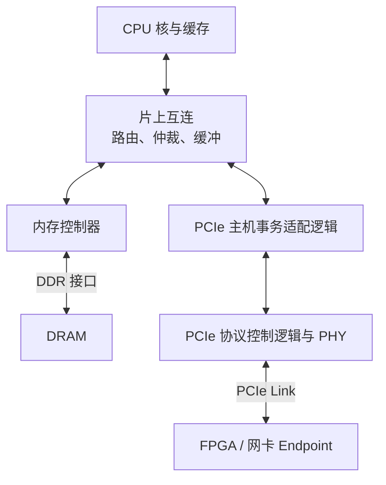

# NetFPGA 2015 Summer Course

> 这份课件主要介绍：FPGA 网卡怎样通过 PCIe 和 DMA 与主机交换数据。涉及内容包括：经典 Host Architecture、PCIe 数据流通路、Scatter-Gather DMA、RIFFA
> 来源：[2015_Summer_Camp_Day4_dma.pdf](https://www.cl.cam.ac.uk/research/srg/netos/projects/netfpga/workshop/technion-august-2015/material/slides/2015_Summer_Camp_Day_4_dma.pdf)


## I. Host Architecture


这一页架构图画的是**通用计算机主机：处理器、内存和外设怎样组织在一起**。

**左侧**主要包含：

| 模块 | 在系统中的作用 |
|---|---|
| Pentium III / Celeron CPU | 执行程序，发起内存和 I/O 访问 |
| 82815 GMCH，即北桥 | 连接 CPU、SDRAM、AGP 显卡和南桥 |
| SDRAM | 保存正在运行的程序和数据 |
| AGP Graphics | 通过 AGP 接口连接的图形处理设备 |
| ICH2，即南桥 | 汇集 PCI、固件存储及其他 I/O 功能 |
| PCI Bus、PCI Slots | 连接可插拔的扩展卡 |
| Flash BIOS | 保存启动固件 |

**右侧**主要包含：

| 模块 | 在系统中的作用 |
|---|---|
| Core 1～4 | 四个执行程序的处理器核 |
| Integrated Graphics | 集成图形处理逻辑 |
| **Hostbridge** | 图中**连接处理器核**、**内存控制器**及 **I/O 通路**的主机侧逻辑集合 |
| Memory Controller | 控制 DDR3 内存访问 |
| PCIe Root Complex Logic | 将主机内部访问与 PCIe 事务衔接起来 |
| **Chipset Interconnect Logic** | **处理 CPU 与芯片组之间的专有互连** |
| Chipset | 承载图中下面一部分 I/O 扩展功能 |
| **PCIe Switch** | 将一条上游通路扩展到多个下游设备 |
| 外接显卡、网卡、SCSI 控制器 | 具体执行图形、网络和存储任务的设备 |

关于右侧的处理器核：**BSP 是 Bootstrap Processor**，表示**启动时承担引导职责的处理器**；`AP` 是 Application Processor，表示其他处理器。这里主要是在标识启动角色。

整体系统能够运行操作系统和应用程序，通过内存保存程序及数据，通过显卡显示，通过网卡联网，通过存储控制器访问存储设备。但是它不是一张完整的主板原理图。**CPU 缓存**、**片上互连**、**时钟**、**电源**、许多外设控制器等都被省略了。

如下对这幅架构图中的一些关键结构做介绍。

### 1.1 “南桥”与“北桥”

北桥、南桥是历史上的芯片组功能划分，左图中它们对应两颗独立芯片。

“北”“南”是**架构图中位置的惯用命名**，不是某种特殊的电路原理。理解它们时，应关注各自连接哪些接口。

---

#### 北桥负责连接当时带宽要求较高的几部分*

左图是早期的“CPU＋北桥＋南桥”架构，其中 82815 GMCH 是北桥，内部大概是这样的：

```d2 layout="tala"
direction: down
cpu_bus_interface: "CPU 总线接口"
b: "地址译码、请求缓冲、数据缓冲、仲裁与路由"
cpu_bus_interface <-> b
hub_interface: "Hub Interface"
SDRAM: "SDRAM 控制器"
AGP: "AGP 控制器"
b <-> hub_interface
b <-> SDRAM
b <-> AGP
```

从数字电路角度，这类芯片通常包含寄存器、地址比较器、FIFO、仲裁器、数据选择器、协议状态机和内存控制逻辑。

例如 CPU 发生一次需要访问 SDRAM 的缓存未命中，简化过程是：

> *CPU 发出访存请求 → CPU 总线**把地址、操作类型传给北桥** → **北桥判断目标属于 SDRAM** → 内存控制器安排 SDRAM 命令 → SDRAM 返回数据 → 北桥通过 CPU 总线返回数据*

例如 82815 的 CPU 总线接口包含：

- `HA[31:3]#`：主机地址信号；
- `HD[63:0]#`：主机数据信号；
- `ADS#`、`DRDY#` 等：事务及数据传输相关控制信号。

到 SDRAM 一侧，则是内存地址、Bank、数据、片选以及读写命令相关信号。**北桥需要协调两侧不同的协议和时序**。

**Hub Interface** 是 Intel 当时用于 **GMCH 与 ICH2 之间的专用互连**，它承载南桥侧与北桥／主机内存侧之间的事务。ICH2 数据手册给出了具体接口信号，例如 `HL[11:0]`、`HL_STB`、`HL_STB#`，后两者是相关的选通信号。[ICH2 Hub Interface 信号说明](https://www.intel.com/content/dam/doc/datasheet/82801ba-i-o-controller-hub-2-82801bam-i-o-controller-hub-2-mobile-datasheet.pdf)

---

#### 南桥负责汇集多种 I/O 控制功能

左图的 ICH2 内部包含 **PCI 接口**、**IDE 控制器**、**USB 控制器**、**中断及定时器功能**、**固件接口**、**电源管理**等。它不是一个单纯的连线汇合点，而是**一颗包含许多控制器和桥接逻辑的芯片**。

假设插在传统 PCI 插槽中的网卡向主机内存进行 DMA 写入，按左图的结构，路径大致是：

> *PCI 网卡 → **PCI Bus** → **南桥的 PCI 桥接逻辑** → Hub Interface → **北桥** → SDRAM 控制器 → SDRAM*

**Firmware Hub Interface** 是南桥访问这类固件器件的接口。相关信号包括

- `FWH[3:0]`: 双向传输信号
- `FWH4`: 控制信号
- 以及时钟、复位等相关连接

---

### 1.2 Host Bridge 与 PCIe Switch

再看右侧，右图展示了部分北桥功能集成进 CPU、外设主要通过 PCIe 连接的较新（当时）架构。

Host Bridge 的核心含义是：**将处理器／主机内存这一侧的访问，与 I/O 总线这一侧的访问连接起来**。

例如：

> CPU 对**设备寄存器进行 MMIO 写** → 主机侧逻辑**识别 I/O 地址** → 生成相应的 PCIe **MemWr TLP**

具体机制取决于平台。**早期北桥承担许多 Host Bridge 功能**，右图则把相关功能画进 CPU 内的绿色区域。Host Bridge 不要求是一颗独立芯片。

---

**PCIe Switch 的典型架构**可以理解为：

{layout="tala"}

这是逻辑拓扑示意，省略了芯片集成位置和厂商内部互连。

典型交换硬件需要**接收 Packet**、**检查 Head**、**判断输出端口**、**进行缓冲和仲裁**，再从相应端口发送。它可以做成独立 ASIC，也可以作为更大芯片中的集成功能。

独立芯片的实际例子是 PEX8605：它具有多个 PCIe 端口和 SerDes，采用实体芯片封装。[Broadcom / PLX PEX8605产品资料](https://docs.broadcom.com/doc/12351821)

---

### 1.3 图中的一些“黄色”模块

| 黄色模块 | 职责 | 连接什么 |
|---|---|---|
| Integrated Graphics | 执行图形处理任务 | CPU 内部互连、主机内存访问通路等 |
| **PCIe Root Complex Logic** | 衔接主机内部事务与 PCIe 事务，处理相关配置和访问 | 主机内部互连、PCIe 端口及其他主机侧逻辑 |
| CPU 内的 **Virtual PCI-to-PCI Bridge** | 表示**根端口的软件可见桥功能** | 主机侧逻辑与下游 PCIe 层次 |
| Memory Controller | 排队、调度内存访问，生成 DRAM 命令 | 主机内部请求接口、DDR3 接口 |
| **CPU 内的 Chipset Interconnect** Logic | 将**内部事务送到芯片组互连**，并**接收返回事务** | CPU **内部互连**、专有芯片组互连 |
| **Chipset 内的 Chipset Interconnect** Logic | 对应上面模块的另一端 | 专有互连、**芯片组内部逻辑** |
| Switch 顶部的 Virtual PCI-to-PCI Bridge | 表示 Switch 上游端口的桥功能 | 上游通路、Switch 内部逻辑 |
| Switch 下方两个 Virtual PCI-to-PCI Bridge | 分别表示两个下游端口的桥功能 | Switch 内部逻辑、各自下游 Link |

---

### 1.4 PCIe Root Complex

PCIe Root Complex，简称 RC，表示 PCIe 层次结构根部、连接**主机处理器／内存系统与 PCIe 设备的一组功能**。它没有唯一固定的 RTL 结构，也不一定是独立芯片。

对一个内存控制器集成在 CPU 内的平台，更适合理解的功能结构是：



某些资料还会把**更多主机侧功能一起括进广义 Root Complex**，因此不同资料的 RC 边界不一定一致。Intel 的历史 **MCH 本身就可以同时包含内存控制功能和 PCIe 根部功能**。[Intel 3000/3010 MCH 数据手册](https://www.intel.com.tw/content/dam/doc/datasheet/3000-3010-chipset-memory-controller-hub-datasheet.pdf)

两种访问走不同分支：

- CPU 访问普通 DRAM：CPU 缓存未命中 → **片上互连** → **Memory Controller** → DDR → DRAM
- CPU 访问 PCIe 设备寄存器：CPU → **片上互连** → **PCIe 主机侧逻辑** → PCIe Link → 设备

而这里的 **Memory Controller** 和 **PCIe 主机侧逻辑**可以**同属于一个 RC 结构**。

可以先把 PCIe RC 理解为：一端接**主机内部事务接口**，另一端接 **PCIe 协议通路的控制硬件**。

一套主机侧 PCIe 实现可以包含这些功能：

| 功能模块 | 保存或处理什么 | 在传输中做什么 |
|---|---|---|
| 主机**内部接口适配** | 地址、读写类型、长度、数据、内部请求编号 | 接收 CPU／片上互连发来的访问，或向主机内存系统发起访问 |
| **地址窗口与转换**逻辑 | 地址范围、映射基址等配置 | 判断**访问应进入哪条通路，必要时转换地址** |
| **TLP 生成与解析**逻辑 | PCIe 数据包头部字段、有效载荷 | 将内部请求组成 PCIe TLP，或从 TLP 中取出内部请求 |
| 未完成请求跟踪 | **Tag**、**内部请求编号**、已返回数据量等状态 | 记住读请求，等待并匹配返回数据 |
| **配置与端口控制** | 端口配置、链路状态、错误及中断状态 | 支持设备配置、状态查询和端口管理 |
| **发送／接收缓冲与流控** | FIFO、缓冲区占用和 Credit 状态 | 在两侧速度或可接收能力不一致时排队、节流 |
| **Data Link 与 PHY** | 校验、重传、链路状态、串并转换等 | 使数据可靠地通过实际 PCIe Link |

**Root Port 是 RC 对外的一条分支端口**，**RC 可以有多个 Root Port**。上述功能也**不一定全部集中在一个 RTL 模块中**。

地址转换、缓存一致性、IOMMU、内存控制器还会与这套逻辑协作。

--- 

### 1.5 Virtual PCI-to-PCI Bridge

先区分两种桥接工作：

- 主机事务适配：例如把 **AXI 写请求**转换成 PCIe **MemWr**。
- PCIe 层次内的桥功能：依据配置决定一个 PCIe 请求应转发到哪条分支。

图中 PCIe Switch 内的虚拟桥，**重点是后者及其软件可见配置**。

看一个完整例子。假设 Switch 下接网卡和存储控制器，系统软件已经配置好如下地址：

| 项目 | 网卡分支 | 存储控制器分支 |
|---|---|---|
| 设备 BAR 窗口 | `0xA0000000～0xA0000FFF` | `0xA0100000～0xA0100FFF` |
| 下游桥的 Memory 窗口 | `0xA0000000～0xA00FFFFF` | `0xA0100000～0xA01FFFFF` |

**桥的窗口覆盖一条下游分支的地址范围**，**可以比单个设备 BAR 窗口大**。

CPU 写 0xA0000100 时，TLP 到达 Switch，硬件判断流程：

> *0xA0000100 **位于网卡分支的 Memory 窗口**内 → 选择通往网卡的下游端口 → 放入**该端口的发送队列** → 经该端口的 PCIe Link 发送*

其核心电路可能包含地址比较器。示意逻辑是：

```verilog
hit_nic = memory_request
       && memory_space_enabled
       && (address >= nic_window_base)
       && (address <= nic_window_limit);
```

它**不需要 CPU 收到每个数据包以后，运行一次软件来决定端口**。 软件提前配置，硬件在传输过程中执行比较和选择。

到网卡以后，还要再判断“**地址是否落在网卡 BAR 窗口内？**”

- 是：减去 BAR 基址，**得到偏移 0x100**，再对**偏移译码**，访问具体寄存器

所以有两个不同层次：

- **桥窗口**：决定走**哪条分支**
- **设备 BAR**：决定**访问设备里的什么资源**

实际端口配置空间确实包含 Memory Base、Memory Limit、Secondary Bus Number 等字段。[Intel PCIe 端口配置寄存器资料](https://www.intel.co.uk/content/dam/www/public/us/en/documents/datasheets/c600-series-chipset-datasheet.pdf)

此外，**不是所有 TLP 都按内存地址选路**：

| 类型 | 主要依据 |
|---|---|
| Memory Read / Write | **目标地址**及相应地址窗口 |
| Configuration Read / Write | **目标 Bus / Device / Function**，以及桥的总线号配置 |
| Completion | **请求者标识**，用于返回原请求者；原请求者再利用 Tag 匹配具体请求 |

**Bus / Device / Function，简称 BDF**，是 PCIe 软件配置模型中**定位某个设备功能的编号**。例如一条分支下面是 Bus 3，另一条是 Bus 4，桥就可以根据总线号配置，将针对 Bus 3 的配置请求送向前一条分支。

“Virtual”表示**它以 PCI 兼容的桥模型被软件发现和配置**。这些配置与转发行为有真实硬件支撑，但不是每个虚拟桥都是一颗独立芯片。[Linux PCIe Port 文档](https://www.kernel.org/doc/html/v6.10/PCI/pciebus-howto.html)

---

### 1.6 Proprietary Chipset Interconnect

Proprietary Chipset Interconnect 可以直译为“**厂商专有芯片组互连**”。它在这张架构图中承担 CPU 与 Chipset 之间的事务传输。

典型例子就是 **Intel 的 DMI** 与 **AMD Infinity Fabric**，连接 CPU 与主板上的**芯片组 (PCH)**，用于扩展出 SATA、USB、更多 PCIe 等低速接口。

> [CPU Port 介绍](/docs/self-cultivation/research/architecture/base/cpu_port/index.md#L57)

--- 

### 1.7 PCI Bus & PCI Slots

PCI Bus 指传统 PCI，是**主板上的共享并行总线**。典型信号包括：

| 信号 | 作用 |
|---|---|
| `AD[31:0]` | 地址／数据复用；不同阶段承担不同内容 |
| `C/BE[3:0]#` | 命令／字节使能 |
| `FRAME#` | 事务相关控制 |
| `IRDY#`、`TRDY#` | 发起方及目标方的数据就绪 |
| `REQ#`、`GNT#` | 总线使用权请求与授权 |

与 PCIe 不同，传统 PCI 中**多个设备共享主要总线信号**，因此**需要协调谁在什么时候驱动总线**。

PCI Slots 就是主板上**可插扩展卡的实体插槽**：塑料连接器、金属触点及相应主板走线。扩展卡金手指插进去后，连接到 PCI 信号、电源和地等。

---

## II. I/O

在计算机组成语境中，I/O 通常指**计算系统与外部设备之间的信息交换**，例如网络、存储、传感器、键盘和显示设备。主存通常作为内存子系统单独讨论。

在芯片电路语境中，I/O 又可以指**芯片与外界的电气输入输出**，这时 DDR 接口也属于芯片的外部 I/O。

在 RTL 语境中，一个模块的 input、`output` 就是它的端口。这些端口可能只连接同一块硅片中的另一个模块，完全没有走到封装外面。

**I/O Controller** 是实际控制某种外设访问的硬件模块。不要求是一颗独立芯片。

> UART 控制器可以只是 SoC 中的一小块 RTL；PCIe 网卡控制器则可能是一颗独立 ASIC，或者由 FPGA 实现。

用 UART 举例。UART 是一种串行收发字节的控制器，其典型内部结构是：

```d2 layout="elk"
direction: down
a: "片内总线接口"
b: "地址译码、控制寄存器、状态寄存器"
c: "TX FIFO / RX FIFO"
d: "发送／接收状态机、移位寄存器、速率控制"
e: "TX / RX 信号"
a <-> b
b <-> c
c <-> d
d <-> e
```

CPU 要发送字节 `0x41`，可以发生如下过程：

> *CPU 写发送数据寄存器 → 总线接口接收地址与写数据 → 地址译码产生 FIFO 写使能 → 0x41 进入 TX FIFO → 发送逻辑取出字节 → 按配置添加起始位、停止位等 → 移位寄存器逐位送到 TX*

**I/O Bus 是主机访问这些 Controller 所使用的互连**。在上述例子中，CPU **可能通过片内 APB 访问 UART**；在网卡例子中，主机通过 PCIe 访问网卡。它可以位于芯片内部，也可以跨越芯片、主板走线和连接器。

---

## III. Scatter-Gather DMA

Scatter/gather DMAs are a special type of streaming DMAs:

- Handle cases when there are several **discontinuous buffers**, all of which need to be transferred to or from the device
- Devices accept a **scatterlist of array pointers and lengths**, and transfer them all **in one DMA operation**
- Good for **"zero-copy" networking** since packets can be built in multiple pieces

Buffer 是用于暂存数据的**一块内存区域**。`Discontinuous buffers` 表示所需**数据分布在多个不相邻的区段中，而不是一个连续范围**。

例如，一项 256 B 任务的数据分布如下：

| 区段 | DMA 起始地址 | 长度 |
|---|---|---:|
| A | `0x10002000` | 64 B |
| B | `0x20004000` | 128 B |
| C | `0x30008000` | 64 B |

每段内部连续，但 A、B、C 彼此不相邻。

"**Scatterlist of array pointers and lengths**" 的意思是：给设备一份列表，每项说明“某段数据在哪里、有多长”。例如可以如下理解：

```text
Entry 0 = {地址 A，长度 64}
Entry 1 = {地址 B，长度 128}
Entry 2 = {地址 C，长度 64}
```

这里的“指针”**不是指应用程序虚拟指针**。Linux DMA API 明确提供**映射后的 DMA 地址和长度**，驱动再将它们组织成设备支持的描述符格式。[Linux Scatter-Gather DMA API](https://www.kernel.org/doc/html/latest/core-api/dma-api.html)

硬件结构方面，相比简单 DMA，SG DMA 增加的主要硬件是：**列表指针／索引寄存器**，其功能：

- 描述符获取逻辑
- 描述符 FIFO
- 地址、长度、标志解析
- 当前区段传输控制
- 切换到下一项

对主机到设备方向，硬件可以执行：

> *读 A 的 64 B → 读 B 的 128 B → 读 C 的 64 B → 向 FPGA 用户逻辑输出一条逻辑上连续的 256 B 数据流*

这就是 **Gather，聚集**。反过来，设备收到一条**连续数据流**，将其分别写入 A、B、C，是 **Scatter，分散**。而这是在 **"one DMA operation"（一次 DMA 操作）** 中完成的。

对网络发送这种类型的任务，**协议头、应用数据等可能分开存放**。SG DMA 能让网卡直接读取这些片段，**减少 CPU 先把它们复制、拼接到连续缓冲区的工作**。这是它有利于“**Zero-copy**”的原因；它**能减少某些软件复制**。

---

## IV. An Example DMA Architecture: UAM DMA

UAM 是马德里自治大学。当时这套设计的目标：

- 面向 Xilinx FPGA，支持 PCIe Gen3 ×8；
- 尽量减少额外逻辑，使设计容易理解；
- 配套 Linux 软件；
- 考虑通过 SR-IOV 支持虚拟化环境。

这里的 SR-IOV 可以先理解为：**同一张物理 FPGA 卡，向主机呈现多个具有独立设备身份的 PCIe Function**，分别接受不同软件实例的控制。

> 例如：见如下架构图中的**多个 User APP 有其独立的 DMA 数据通路**，而普通 FPGA 板卡中只有一条数据通路？（存疑）

先统一两个方向名称：

| 课件名称 | 全称 | 实际数据方向 | FPGA 发起的主要 PCIe 事务 |
|---|---|---|---|
| C2S | Card to System | FPGA 卡 → 主机内存 | MemWr |
| S2C | System to Card | 主机内存 → FPGA 卡 | MemRd，随后接收 CplD |


### (1) 7 Series FPGAs Integrated Block for PCIe

右上角的 7 Series FPGAs Intergrated Block for PCIe 是 Xilinx 提供的用于在 FPGA 中实现 PCIe 接口的 **IP 核**，即我们之前提到的 **PCIe Controller**。

外侧连接：

- `pcie_rx`、`pcie_tx`：PCIe 串行接收、发送通道，实际包含各 Lane 的差分信号；
- `pcie_clk`：参考时钟；
- `pcie_rst`：复位。

**内侧连接的是 FPGA 内部的并行接口**。图中的 CLK 250 MHz 是这一侧逻辑使用的时钟。

它提供了四组重要的 AXI-Stream 接口：

| 接口 | 从 FPGA 应用逻辑的角度看 | 典型用途 |
|---|---|---|
| **CQ：Completer Request** | 接收其他设备发给本 FPGA 的请求 | CPU 读写 FPGA 的 BAR 映射寄存器 |
| **CC：Completer Completion** | 返回上述请求所需的 Completion | FPGA 返回 CPU 所读的状态寄存器值 |
| **RQ：Requester Request** | FPGA 主动向外发起请求 | DMA 的 MemRd、MemWr |
| **RC：Requester Completion** | 接收上述请求的 Completion | 接收 DMA MemRd 对应的 CplD |

这些名称都**以 FPGA Endpoint 的角色为参照**。同一个 FPGA，既可以是主动发起 DMA 的 Requester，也可以是响应 CPU 寄存器访问的 Completer。

**AXIS** 是 **AXI-Stream** 的缩写，对应 FPGA 内部真实的并行连线，例如：

- `tdata`: 当前拍的接口描述信息或数据
- `tvalid`: 发送方声明当前内容有效
- `tready`: 接收方声明能够接受
- `tkeep`: 标记有效的数据位置
- `tlast`: 标记接口数据包结束
- `tuser`: 携带接口规定的附加信息

---

### (2) PCIe Completer

右下角的 PCIe Completer **负责 CPU 对 FPGA 寄存器的访问**。

这一块包含请求解析、BAR/偏移地址译码，以及本地寄存器读写控制。例如，CPU 要把 DMA 长度设置成 512，硬件过程是：

> *CPU 执行 MMIO 写 → 主机生成 MemWr TLP → FPGA PCIe IP 接收 → **CQ 接口交给 Completer logic** → **解析目标 BAR、寄存器偏移、写数据及字节使能** → 选中 LENGTH 寄存器 → 产生本地写使能，将 512 写进去*

CPU 随后读取状态时：

> *CPU 执行 MMIO 读 → MemRd TLP → **CQ** → **Completer 选中 STATUS 寄存器** → 取得寄存器值 → **通过 CC 提交 Completion** → PCIe IP 发出 CplD → CPU 原来的读操作得到结果*

图中的 MUX 和 `DIN`/`DOUT`/`EN`/`WE`/`ACK`，表示**把这种访问连接到各组本地寄存器的接口**：

- `DIN`/`DOUT` 承担读写数据；
- `EN` 选择一次本地访问；
- `WE` 指示写入；
- `ACK` 表示本地访问得到响应（不是 PCIe Data Link Layer 的 ACK DLLP）。

---

### (3) User App

左侧的 User App 指用户硬件逻辑。

它可以是：

- 网络包处理电路；
- 数据生成器、采集器；
- 神经网络计算模块；
- 连接本地 BRAM 的读写适配器。

以编号为 0 的一组接口为例：

- User app ── AXIS C2S0 ──> DMA logic
- User app <─ AXIS S2C0 ─── DMA logic

其含义是：

- **C2S**：用户硬件把数据交给 DMA，让 DMA 写入主机内存；
- **S2C**：DMA 读回主机数据，再通过流接口交给用户硬件。


---

### (4) S2C/C2S Engine in DMA Logic

下半页的 S2C/C2S Engine 是**真正执行 DMA 的控制和数据通路**。

以 C2S 为例，图中画了：

```text
描述符表：
    Descriptor 1：Address、Size
    Descriptor 2：Address、Size
    ...
    Descriptor N：Address、Size

控制状态：
    Current
    Last active

数据缓冲：
    Data FIFO
```

这里至少有三类实际硬件。

1. 第一类是**描述符存储和选择电路**。描述符可以**由寄存器阵列或 BRAM** 等实现，**保存主机缓冲区的 DMA 地址和长度**。
2. 第二类是**状态机、计数器和地址计算电路**。例如描述符指定：
    
    ```text
    Address = 0x20000000
    Size    = 512
    ```

    状态机会维护“**已经处理多少字节、还剩多少字节、下一次 PCIe 请求使用什么地址**”。
3. 第三类是**数据 FIFO**。它**缓冲用户逻辑和 PCIe 接口之间速率暂时不匹配的数据**，不需要一次装下整个大缓冲区。

`Current` 指向当前处理的描述符，`Last active` 指定本批有效描述符的末端。图中的回绕箭头表示**描述符槽位可以循环使用**。

---

### (5) SR-IOV Arbiter

中间的 SR-IOV Arbiter 功能定位是：**多个 DMA 通路共享 PCIe IP**。

**假设两个 DMA 通路同时准备好请求，硬件不能让它们同时驱动同一组 RQ 信号**。仲裁器需要：

1. 选择当前允许发送的通路；
2. 把它的请求送往 RQ；
3. 保持请求所属 Function 等上下文；
4. 将收到的 Completion 分发到正确的 DMA 通路。

---

### (6) IRQ Manager

**IRQ Manager 把 DMA 事件转换成中断请求**。

DMA 完成或发生异常后，将事件交给 IRQ Manager。它负责：

> *确定中断来源 → 选择 MSI-X 表项 → 检查屏蔽状态 → **必要时记录 Pending Bit** → **向 PCIe IP 提供中断地址、数据及发送请求***

图中的 MSI-x Table 和 Pending bit array，正是我们前面讨论过的 MSI-X 表与 PBA。这里能看到**它们被放在 FPGA 的应用逻辑一侧**。