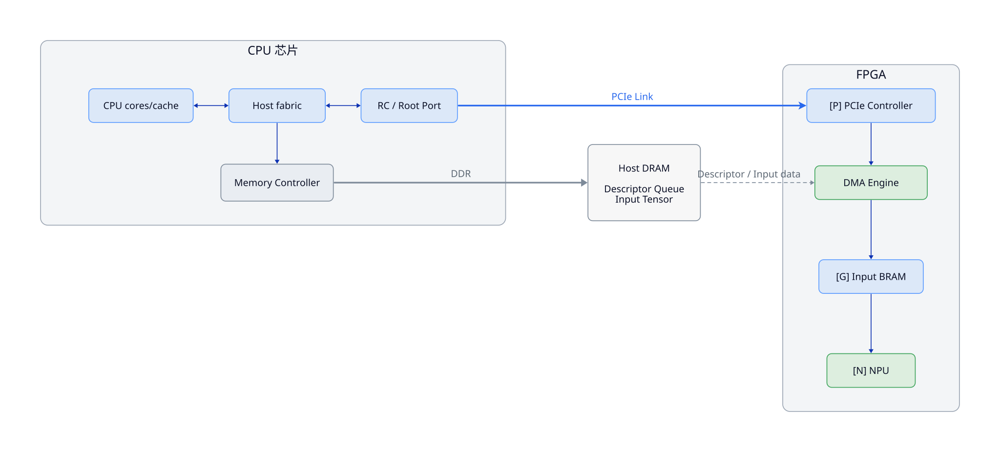
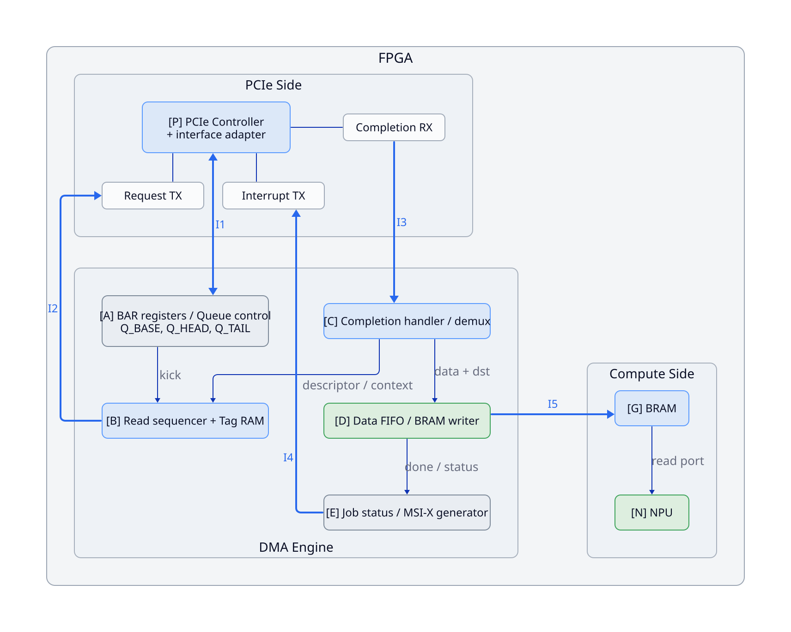
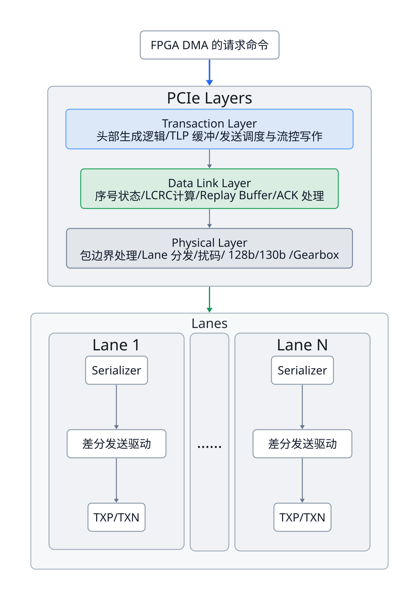

# PCIe 与 DMA：硬件设计与数据通路

> 本文以 CPU-FPGA 系统为例，介绍 PCIe, DMA 相关模块的底层硬件设计与数据通路相关内容。

## I. Example Architecture

考虑一个板级互联系统，CPU 与 FPGA 通过 PCIe 连接，CPU 运行操作系统和主机软件，FPGA 负责运行神经网络推理。权重保存在 FPGA 内部，输入数据需要从主机内存搬运至 FPGA 计算侧。`NPU` 在这里指 FPGA 内执行神经网络计算的硬件。`P` 包含 PCIe Controller，以及将厂商接口适配为下述接口的少量逻辑。

CPU-FPGA 系统架构：

<!--  -->

{layout="tala", width="100%"}

FPGA 内部展开：

<!--  -->

{layout="tala", width="80%"}

探讨分析：

1. PCIe 在硬件中的模块组成
2. DMA 在硬件中的模块组成
3. 一次真实的、运行在 PCIe 上的 DMA 传输的完整数据通路

## II. More Detailed Architecture

**更完整清晰的系统架构图**如下。这里我们会展开之前为显式突出的 PCIe Controller IP, BAR Bridge, IOMMU, Coherency Fabric, RQ/RC/CQ/CC 等结构。

{layout="elk", width="70%"}

FPGA 内部架构展开见：

{layout="elk", width="70%"}

上述架构图中的 `P` 将 PCIe Controller IP 与 Interface Adapter 抽象为一个整体，这里**着重展开一下 `P` 以及 FPGA 的内部结构**。我们选择 **AMD UltraScale+ PCIe Integrated Block 的 RQ/RC/CQ/CC 接口族**作为具体参照。

`P` 是一个包装层：内部包含 **PCIe Hard IP，以及 RQ Formatter、RC Parser/Aligner、CQ/CC BAR Bridge 等适配逻辑**。Hard IP 不会直接输出本文自定义的 `rd_addr` 或已经去头的 `cpl_data`。

| Hard IP 接口 | 请求角色、方向（以 FPGA 应用逻辑为参照） | 本例承载的事务 |
|---|---|---|
| **RQ：Requester Request** | FPGA 作为请求者，**用户逻辑 → IP** | 描述符 MemRd、R0/R1 MemRd (**I2**) |
| **RC：Requester Completion** | FPGA 收到自己发起请求的完成，**IP → 用户逻辑** | 描述符 CplD、四个数据 CplD (**I3**) |
| **CQ：Completer Request** | FPGA 作为被访问者，**IP → 用户逻辑** | Host 写队列配置、Doorbell；Host 读状态 (**I1**) |
| **CC：Completer Completion** | FPGA 回复 Host 发起的 Non-Posted 请求，**用户逻辑 → IP** | 状态 MMIO Read 的 CplD (**I1**)|

对应原文接口编号和硬件展开关系：

| 原接口 | 展开后的硬件边界 | 片内协议选择 |
|---|---|---|
| `I1` | CQ/CC BAR Bridge ↔ **A 与 E 的寄存器窗口** | **32-bit AXI4-Lite**；也可保留原自定义寄存器接口 |
| `I2` | B → RQ Formatter → Hard IP | 自定义命令握手 → **PCIe AXI4-Stream** 接口格式 |
| `I3` | Hard IP → RC Parser/Aligner → C | **PCIe AXI4-Stream** → 去头、对齐的数据与元信息 |
| `I4` | E → 中断适配逻辑 → Hard IP | MSI-X 专用接口或共享 RQ 的 MemWr，取决于配置 |
| `I5` | D → G | 原生同步 BRAM 写端口；可选替换为 AXI4-MM 写通路 |


端口的 `m_axis`/`s_axis` 命名是**从 PCIe IP 的视角**命名：

- IP 输出 Packet 的 RC/CQ 接口信号使用 `m_axis_rc_*`、`m_axis_cq_*`
- 应用送入 IP 的 RQ/CC 接口信号使用 `s_axis_rq_*`、`s_axis_cc_*`。
- READY 信号始终沿数据反方向传播。

| 信号族 | IP 原生接口上的含义 | 本例须注意 |
|---|---|---|
| `*_tdata` | Descriptor 与可能存在的 Payload | 256 bit |
| `*_tvalid` | 发送方当前提供的 beat 有效 | 不能等待 READY 后才决定是否发 VALID |
| `*_tready` | 接收方可以接受当前 beat | **同一采样沿 VALID 与 READY 同时有效才传输**；某些原生端口为同值多 bit |
| `*_tkeep` | 当前 beat 的有效 **DW** | 256-bit 接口为 8 bit，相当于“**掩码**” |
| `*_tlast` | 本配置下当前原生 Packet 结束 | straddle 关闭，不是整个 DMA Job 完成 |
| `*_tuser` | BE、包界定、属性等接口特有侧带 | 各通道含义/宽度不同，按生成 IP 定义 |

需要注意：

- PCIe 用户接口**通常工作于 IP 给出的 `user_clk`**，并有对应 user reset 和 link-up 状态。
- **RQ/RC/CQ/CC 采用 AXI4-Stream 握手**，传输内容有厂商定义的 **Descriptor、Payload 和 TUSER**。

---

## III. An Example DMA Read Task

我们以如下 DMA 任务为例：

> FPGA 通过 DMA (运行在 PCIe 链路) 的方式，从 CPU DRAM 获取一段 Input Tensor 数据，进行神经网络推理。

探索每个环节在硬件侧到底会发生什么事情、哪些模块参与数据通路、接口/信号如何变化等细节。本文意图打通“软件程序——协议规范——硬件底层”整个图景，作为 baseline。后面想要了解其他更高级的概念只需要在上面添砖加瓦即可。

CPU, DMA Engine, PCIe Controller 这三个角色是后续频繁出现的结构，这里先明确它们的分工职责。

- **CPU／驱动指定任务参数**：输入在哪里、放到 FPGA 哪里、总共搬多少。
- **DMA Engine 执行并细化任务**：将任务拆成哪些 PCIe 请求、分配什么 Tag、什么时候发、返回数据放哪里、何时完成。
- **PCIe Controller 执行协议传输**：编码和解析 TLP，管理链路发送、流控、校验及重传等。

此外，需要明确如下连接：

- `C → B`：返回描述符内容，以及读请求完成、出错等信息；`C` 查询 `B` 中的 Tag 上下文。
- `D → E`：实际写入 BRAM 的字节数、写入完成状态。
- `B/C → E`：请求进度和错误。
- `E → A → I1`：CPU 可以通过 BAR 寄存器读回任务状态。
- `E → N`：输入全部有效后，通知 NPU 可以使用该缓冲区。

这些连接分别会在对应阶段中使用。

本例参数固定如下：

```text
CPU 通过将 Descriptor 放在 DRAM 中使得 Descriptor 对 FPGA 可见：
主机描述符队列的 DMA 地址：0x10000000
描述符队列容量：16 项
每项描述符位宽：32 B

输入数据的 DMA 地址：0x20000000
输入长度：512 B，例如 512 个 INT8 数值

FPGA 输入缓冲区的本地字节地址：0x8000
目标范围：0x8000～0x81FF

本任务 Job ID：7
最大单次读请求长度：256 B
每个数据 CplD 携带：128 B
FPGA 本地数据通路宽度：256 bit，即每拍 32 B
```

**主机 DMA 地址和 FPGA 本地地址属于不同地址域。** `0x8000` 是 FPGA 内的目标位置，不是主机 DRAM 地址。

### Step 1. 初始化：CPU 先告诉 FPGA“描述符队列在哪里”。

这是设备启动时进行的配置，不必每搬一块数据都重做。

驱动完成设备枚举、BAR 映射、允许设备发起访存等准备，然后通过 MMIO 配置 `A: BAR Registers`：

```text
Q_BASE   = 0x10000000
Q_SIZE   = 16
Q_HEAD   = 0
Q_TAIL   = 0
Q_ENABLE = 1
```

其中：

- `Q_HEAD`：本例硬件**当前处理的队列位置**。
- `Q_TAIL`：软件**已经提交到的位置**。

当 `Q_HEAD == Q_TAIL` 时，表示当前没有待处理描述符；当 `Q_HEAD != Q_TAIL` 时，表示队列中存在待处理描述符。

本例还提前配置好一个 MSI-X 中断项及其主机处理程序。

**实际硬件路径：**

> *CPU MMIO 写 → 主机 RC 生成 MemWr TLP → PCIe Link → P: PCIe Controller CQ 接口解析主机对 BAR 访问 → I1(AXI4-Lite) → A 的地址译码和寄存器写使能*


`I1: PCIe Controller -> BAR Registers` 可以提供这样的内部信息：

这里我们**展开为了相对原文更详细的 AXI4-Lite 内部互连**。 

```text
m_axis_cq_tdata
m_axis_cq_tvalid
m_axis_cq_tlast
m_axis_cq_tkeep
m_axis_cq_...
```

为了使初始化、Doorbell 和状态回读落到可实现的地址译码，给出一份**本文自定义**的 BAR0 寄存器表。沿用 `Doorbell=0x10`、`JOB_STATUS=0x18`。

**CQ/CC BAR Bridge 是 AXI4-Lite Manager，A、E 及 MSI-X 表窗口是被访问端。** 这里的 AXI4-Lite **只有单拍访问**，无 `AxLEN/WLAST`。[AXI4-Lite：Arm IHI 0022H.c，Part B](https://documentation-service.arm.com/static/602a9df190ee6824a1e02b98)

| BAR0 偏移 | 寄存器 | 属性 | 硬件行为 |
|---:|---|---|---|
| `0x00` | `Q_BASE_LO` | RW，停机时改 | **描述符队列**的 DMA 地址低 32 bit，本例 `0x10000000` |
| `0x04` | `Q_BASE_HI` | RW，停机时改 | 地址高 32 bit，本例 0 |
| `0x08` | `Q_SIZE` | RW，停机时改 | **描述符队列**物理槽数，本例 16 |
| `0x0C` | `Q_HEAD` | RO | 已退休位置；禁用且排空后的初始化将其清零 |
| `0x10` | `Q_TAIL_DOORBELL` | RW | 写入已发布尾位置；读回当前 tail；产生重新检查队列的条件 |
| `0x14` | `Q_CTRL` | RW | bit 0=`ENABLE`；其余位保留 |
| `0x18` | `JOB_STATUS` | RO | 最近任务的 DMA 状态；NPU 状态另存 |
| `0x1C` | `JOB_ID` | RO | 最近完成/失败任务的 ID，本例 7 |
| `0x20` | `BYTES_DONE` | RO | 该任务已经提交到目标存储的有效字节数 |
| `0x24` | `ERROR_CODE` | RO | 描述符、Completion 或本地写错误原因 |
| `0x28` | `IRQ_CAUSE` | W1C | 软件写 1 清除对应原因；同拍新事件优先保留 |
| `0x2C` | `IRQ_MASK` | RW | 设备事件的通知屏蔽；与 MSI-X 表项 Mask 分开 |
| `0x30` | `BUFFER_STATUS` | RO | bit 0=`INPUT_VALID`；由缓冲区所有权控制器维护 |
| `0x34` | `NPU_STATUS` | RO | 输入任务已接收、计算中、计算结束等状态 |

> 1. MSI-X Table 沿用附录 B 的 `BAR0+0x1000`，另为 PBA 分配合法且不重叠的区域，并在 Capability 中声明。
> 2. 原 Step 1 的 `Q_HEAD=0、Q_TAIL=0` 可理解为**设备/队列初始化后的状态**。

---

### Step 2. 准备任务：CPU 将输入数据和描述符发布到设备可读取的内存中。

假设应用程序已经**准备好 512 B 输入张量**。**驱动建立合法的 DMA 映射**，并取得本例的设备可用地址 `0x20000000`。

随后，CPU 在队列第 0 项写入一个描述符。本文规定其布局为：

```text
偏移       字段             本例值
+0x00      SRC_DMA_ADDR     0x0000000020000000    64 bit
+0x08      DST_LOCAL_ADDR   0x0000000000008000    64 bit
+0x10      LENGTH_BYTES     512                   32 bit
+0x14      OPCODE           H2C_READ              16 bit
+0x16      FLAGS            完成后请求中断          16 bit
+0x18      JOB_ID           7                     32 bit
+0x1C      RESERVED         0                     32 bit
```

`H2C` 表示 Host-to-Card，也就是主机到 FPGA 卡的**数据方向**。

**描述符本身就是主机内存里的 32 B 二进制内容。** FPGA 之后会读取这些字节，按约定字段切分，装入硬件寄存器。

CPU 必须保证：**输入数据已经对 DMA 可见，描述符内容已经对 DMA 可见**，再通知 FPGA 读取。

这涉及 DMA 映射／同步和写入**顺序保证**。描述符队列常用 coherent DMA 内存；即便如此，仍可能需要**内存屏障**来保证发布顺序。

此时 CPU 正在做的是准备任务，FPGA **尚未取得任务内容**。

---

### Step 3. Doorbell：CPU 通知 FPGA“第 0 项描述符已经准备好了”。

**驱动向 Doorbell 寄存器**写入新的尾位置：

```text
Q_TAIL_DOORBELL = 1
```

**Doorbell 是一个具有通知语义的设备寄存器。** 它可以记录新的队列尾指针，并**触发硬件检查队列**。

假设其位于 BAR0 偏移 `0x10`，则 CPU 发出的访问在 PCIe 上是：

```text
MemWr TLP
    Address = BAR0 对应的 PCIe 地址 + 0x10
    Length  = 1 DW
    Payload = 1
```

`P: PCIe Controller` 接收并解析后，经 `I1` 使 `A: BAR Registers` 执行：

```text
Q_TAIL ← 1

发现 Q_HEAD=0、Q_TAIL=1
    → 产生 kick
    → 唤醒 B: Read Sequencer 的描述符读取状态机
```

**Doorbell 里的 `1` 是本例约定的队列尾位置。**

这也解释了两种提交方式的区别：

- 直接 MMIO 写寄存器方式：CPU 将每个任务的地址、长度等**直接写入设备任务寄存器**。
- 描述符方式：CPU 将任务参数写进**主机内存**，设备寄存器**保存队列位置**，**Doorbell** 通知设备获取新描述符。真实商用 FPGA DMA IP 很多采用这一种。[AMD H2C 流程](https://docs.amd.com/r/4.1-English/pg195-pcie-dma/Example-H2C-Flow)

!!! "Note Ring Queue and Doorbell"
    **环形队列并不只需要两个指针寄存器**。
    本例使用最容易实现的一种约定：**16 个物理槽，即保留 1 槽区分满与空，最多提交 15 个未退休项**。槽索引为 4 bit，`tail` 指向下一个可发布位置，`head` 指向下一个待处理/退休位置。

    \[
    \mathrm{empty}=(head=tail),\qquad
    \mathrm{full}=((tail+1)\bmod16=head)
    \]

    **一个 Doorbell 可以发布多项任务。** 例如从 tail=0 更新到 3，表示槽 0、1、2 已准备好；**B 应持续工作直到 head 追上 tail**，而不是把 Doorbell 当作“只执行一次”的脉冲。

    除此之外，还有如下复杂情况：

    1. **多 Job 并行处理**：本文案例可逐个串行处理 DMA Job，并在 Job 退休时推进 head。要进一步并行处理多个 Job，需要分别维护 **fetch/dispatch 指针、retire 指针、每个 Job 的状态和缓冲区所有权**。
    2. 队列槽的生命周期为：*软件填写 → 发布 tail → **B 获取并保存完整描述符** → Job 结束并退休 → 软件允许复用*。`JOB_ID/JOB_STATUS` 可能**被后续完成覆盖**，因此驱动应该在确认/清除 `IRQ_CAUSE` 前保持结果不被覆盖、阻止下一 Job 退休。高吞吐实现还可能**增加完成记录 FIFO 或主机完成队列**。

---

### Step 4. 获取描述符：FPGA 首先发出一个读取元数据的 PCIe 请求。

现在活动的是 

- A: BAR Registers
- B: Scheduler
- P: PCIe Controller
- 主机 RC
- 主机内存系统
- C: Completion Handler

`B` 已经从 `A` 知道队列基址和当前位置，因此可以计算：

```text
descriptor_addr
    = Q_BASE + Q_HEAD × descriptor_size
    = 0x10000000 + 0 × 32
    = 0x10000000
```

队列基址 `Q_BASE` **通过初始化寄存器提供**。

本例**由 `B` 分配 Tag `0x01`，建立上下文**：

```text
Tag 0x01：
    kind          = DESC
    expected_size = 32 B
    destination   = B 的描述符寄存器
```

随后通过 `I2` (**B → RQ Formatter → Hard IP**) 向 `P: PCIe Controller` 提交读命令：

```text
rd_req_valid = 1
rd_addr      = 0x10000000
rd_len_bytes = 32
rd_tag       = 0x01
```

当 `rd_req_valid && rd_req_ready` 成立，`P` 接受命令。**若尚未接受，`B` 保持这些信息，不反复创建新请求**。

!!! Attention "拆解 I2: B → RQ Formatter → Hard IP"
    `B` 发出的 `{rd_addr, rd_len_bytes, rd_tag}` 先进入一个命令保持寄存器/FIFO。RQ Formatter 从中形成 **128-bit Requester Request Descriptor**。到这里说 B → RQ Formatter 的传输路径，可采用**自定义命令握手协议**。
    
    接下来 RQ Formatter 通过 **AXI4-Stream 协议**，
    提供 `s_axis_rq_tdata/tkeep/tlast/tuser/tvalid`，Hard IP 通过 `s_axis_rq_tready` 表示接受。

    在本节选择的 256-bit、无 straddle、DW 对齐模式下，一个没有 Payload 的 MemRd 可以在一个 RQ beat 内提交：

    | RQ 字节 lane | 内容 |
    |---|---|
    | 0～15 | 128-bit RQ Descriptor |
    | 16～31 | 无效 |

    此时 `TKEEP=8'h0F、TLAST=1`。**这里 TKEEP 每 bit 表示一个 32-bit DW 有效**，不是普通应用流的逐 Byte keep。

    请求从生成到发出可以有三个事件：

    1. **调度器保留资源**：拿到 Tag、写好上下文、预留返回容量。
    2. **命令进入 RQ Adapter**：I2 成功握手，B 才推进 `src/remaining`。Adapter 接管稳定保持命令的责任。
    3. **原生 RQ 包被 IP 接受**：Packet 最后一拍完成握手，IP 后续按链路状态及流控发送。

    这三个事件位于不同周期。RQ 被**阻塞**时，**Adapter 保持 Descriptor、TUSER、TKEEP、TLAST 和 VALID**，不得再次分配 Tag。

    一般请求切分除了 MRRS，还要考虑 4 KiB 边界、剩余长度和实现自己的最大请求粒度。对本例对齐地址，可写为：

    \[
    L_{next}=\min(L_{remain},MRRS,4096-(A_{src}\bmod4096),L_{impl})
    \]

    **每次接受一个命令后才更新源地址和剩余长度**。

`P` 将其组织成 **MemRd TLP**：

```text
Address      = 0x10000000
Length       = 8 DW
Requester ID = 本 FPGA Function 的身份
Tag          = 0x01
Payload      = 无
```

然后按 PCIe 规则发送。**主机 RC 接收后，将 DMA 地址经必要转换，交给主机内存系统读取这 32 B**。

主机返回成功的 CplD：

```text
Requester ID = 原 FPGA
Tag          = 0x01
Payload      = 32 B 描述符内容
```

到 FPGA 后：

```text
P 解析 Completion
    → I3 将 Tag、状态和数据交给 C: Completion Handler
    → C 查询 Tag Context RAM 获取上下文，得到 kind=DESC
    → C 将数据送入 B: Scheduler 的描述符寄存器
```

**这批返回数据不会被 Completion Handler 进一步写进神经网络输入缓冲区，因为 Tag 上下文已经说明它是描述符。**

`B` 解析并检查操作类型、长度、本地目标范围等，得到：

```text
src_dma   = 0x20000000
dst_local = 0x8000
total_len = 512
job_id    = 7
```

描述符读结束后，Tag `0x01` 可以按接口规则回收。

所以FPGA 在 DMA 获取**真正输入数据前，已经已经使用了同一条 PCIe Requester 读通路获取任务元数据**

> "**DMA 地址与 DMA 地址翻译**"中的细节详细展开见下文。

---

### Step 5. 执行任务：DMA 将 512 B 输入拆成两个读请求，并保存各自上下文。

这时任务参数来自 CPU 写入的描述符，具体请求由 `B`: **Scheduler** 自动计算。

本例**单次请求上限是 256 B**，地址又没有跨越 4 KiB 边界，因此拆成：

```text
请求 R0：
    主机 DMA 地址 = 0x20000000
    长度          = 256 B
    本地目的地址  = 0x8000
    Tag           = 0x10

请求 R1：
    主机 DMA 地址 = 0x20000100
    长度          = 256 B
    本地目的地址  = 0x8100
    Tag           = 0x11
```

`B`: **Tag Context RAM 保存**：

```text
Tag 0x10 → DATA，Job 7，本地基址 0x8000，请求长度 256 B
Tag 0x11 → DATA，Job 7，本地基址 0x8100，请求长度 256 B
```

这里 `Tag` 的作用是：**当返回数据到达时，查回它属于哪次读请求、应写入哪里。** 

> 本例选择**由 DMA 分配 Tag、PCIe IP 接受应用提供的 Tag**。**其他实现可以由 IP 分配并反馈给 DMA**，但必须保持一致的管理方式。[AMD Tag 管理说明](https://docs.amd.com/r/zh-CN/pg213-pcie4-ultrascale-plus/%E9%9D%9E%E8%BD%AC%E5%8F%91%E4%BC%A0%E8%BE%93%E4%BA%8B%E5%8A%A1%E7%9A%84%E6%A0%87%E7%AD%BE%E7%AE%A1%E7%90%86)

**Outstanding Request 在这里出现。**

如果 **R0 已发出、数据尚未收齐**，`B` 不必停下来等待；**资源允许**时，它**继续发 R1**。

当两者均已发出而尚未完成：

```text
Outstanding reads = 2
```

这是两个尚未结束的 PCIe 读事务，不是两个 DMA 任务。它们共同服务于 Job 7。

**Credit 在实际发送处发挥作用。**

每个 MemRd 没有 Payload，**但是**发送时**也**需要相应的 **Non-Posted Header Credit**。假设当前主机已通告足够的额度，`P` 可以发送两个请求；若额度不足，它必须等待。

!!! Note "理解 Tag & Credit"
    - Tag 是否可用：我有没有能力记住并区分这次读请求？
    - Credit 是否足够：相邻接收端是否允许我继续发送这一类数据包？

它们是两种不同约束。**DMA 还必须预留返回数据的缓冲能力**，本例允许两个 256 B 读请求并发，**就必须能妥善接收和处理**它们的返回数据。

**Credit 由 PCIe Controller 管理**：它可能先缓存命令再等待发送，缓冲满后**通过 AXI4-Stream 协议的信号 `rd_req_ready=0` 反压 `B`**。[AMD PCIe Credit 说明](https://docs.amd.com/r/en-US/pg054-7series-pcie/Receiver-Flow-Control-Credits-Available)

!!! Attention "B/C 对 Tag Context RAM 的并行访问"
    `B: Read Sequencer + Tag RAM` **实际上包含几组并行电路**，而非“发请求 → 等返回 → 再发请求”这样简单的状态机。

    | 子模块 | 寄存器/RAM 与组合逻辑 | 与其他模块的交互 |
    |---|---|---|
    | Descriptor Controller | 32 B 描述符寄存器、字段检查、队列 FSM | 选择 DESC 请求，接收 C 返回的描述符 |
    | Request Scheduler | 源/目的地址寄存器、剩余长度减法器、边界比较器 | 每次选择 DESC 或 DATA 请求，检查资源 |
    | Tag Allocator | free bitmap 或 free-list、分配优先编码器 | 分配时清空闲位，安全完成后置回 |
    | Tag Context RAM | 按 Tag 寻址的上下文存储 | **B 建表，C 查表**并更新接收进度 |
    | RQ Command FIFO | 地址、长度、Tag | **隔离资源分配与 RQ 背压** |
    | Job Tracker | 已提交字节/请求数、未完成数、错误锁存 | 向 E 汇总 |

    **Tag RAM 若由同步 BRAM 实现，查表有读延迟。** 
    一种可实现的 C 流水线是：
    
    1. 第 0 拍握手**接收/锁存 Completion 元信息**并**发出 Tag 读地址**；
    2. 第 1 拍**取得上下文、检查范围和状态**；之后产生带目的地址的数据记录。
    
    **到来的 Payload 在 skid buffer/FIFO 中等候**。

---

### Step 6. PCIe Controller 与主机完成两个 MemRd 的传输和主存读取。

两个数据请求**在 PCIe 上**分别包含：

```text
R0：MemRd，Address=0x20000000，Length=64 DW，Tag=0x10
R1：MemRd，Address=0x20000100，Length=64 DW，Tag=0x11
```

注意三个位置的长度单位：

```text
描述符总长度：512 字节
单次请求长度：256 字节
TLP Length：64 DW
```

`P` 的协议硬件负责：

```text
请求信息形成 TLP 头部
    → 按流控条件安排发送
    → 添加本 Link 的序号与 LCRC
    → 保存必要的重传副本
    → PHY 编码、串行化
    → 通过 PCIe 差分线发送
```

**CPU 没有为 R0、R1 分别执行一次软件提交**，它们是 `B` 的状态机、地址加法器和长度计数器自动产生的。

主机 RC 收到请求后，**保留 Requester ID、Tag 等返回关联信息**，将请求转换为**主机内存系统中的读取**：

```text
PCIe DMA 地址
    → 必要的地址转换／权限检查
    → 主机内部读请求
    → 内存系统返回数据
    → RC 生成 CplD
```

- 对于**访问 DRAM 的请求**，内存控制器按 Bank、行状态和时序安排命令，再通过 DDR 接口取回数据；
- 进一步，支持 **I/O 一致性的平台**，也可能从**缓存系统满足部分访问**。

!!! Attention "DMA 地址与地址翻译"
    **DMA 地址是驱动交给设备、供设备在 DMA 请求中使用的地址**。它不一定等于 CPU 物理地址。

    启用 IOMMU 地址翻译时，**这种设备侧地址通常称为 IOVA (I/O Virtual Address)** ，即 **I/O 虚拟地址**。未启用翻译时，DMA 地址可能直接等于物理地址，也可能经过主机桥的地址窗口转换。

    设备访问 CPU 内存系统的 "DMA 地址"，其**诞生和翻译流程**如下：

    先由**软件建立映射**，再由**硬件**在请求到达时**执行翻译**。 

    1. **驱动准备缓冲区并请求 DMA 映射**
        在 Linux 中，驱动可以通过类似下面的调用获得设备可使用的地址：

        ```c
        dma_addr = dma_map_single(dev, cpu_buffer, 512, DMA_TO_DEVICE);
        ```

        这里 `DMA_TO_DEVICE` 表示数据从主机内存流向设备。调用成功后，返回本例的：

        ```text
        dma_addr = 0x20000000
        ```

        **操作系统的 DMA / IOMMU 子系统负责安排映射**。驱动随后将这个返回地址**写入描述符**。
    2. **操作系统建立设备对应的 I/O 地址翻译表**
        假设本 FPGA 的 **Requester ID** 是 01:00.0，操作系统为它**关联了地址翻译域 D3**。该域中存在类似下面的映射：

        ```text
        IOVA 页：0x20000000
            → 主机物理页：0x0000000123456000
            → 允许设备读取
        ```

        **地址翻译域**可以理解为一套设备访问所使用的映射及权限配置，它通常可以包含**多级页表**，保存在**主机内存中**。
    3. **FPGA 发出带 IOVA 的 MemRd**
        例如本案例中的第二个数据请求：

        ```text
        Requester ID = 01:00.0
        Address      = 0x20000100
        Length       = 256 B
        Tag          = 0x11
        ```

        **此时的 `Address` 就是 DMA 地址，也就是 IOVA**，不一定等于主机物理地址。
    4. **主机的 IOMMU 硬件执行翻译**
        功能上的通路是：Host PCIe Root Complex 接收到请求，由 **IOMMU** 根据 Requester ID 选择翻译上下文，**查找 IOVA 的映射和读写权限**，得到主机物理地址，**向主机内存系统提交访问**。
        例如本例的地址翻译：

        ```text
        IOVA：       0x20000100
        页内偏移：   0x100

        物理页基址： 0x0000000123456000
        最终物理地址：0x0000000123456100
        ```

    
    关于地址翻译的硬件单元 IOMMU，Intel 平台通常由 **VT-d DMA Remapping** 硬件承担这类工作；Arm 平台有相应的 **SMMU**。具体模块在芯片中的集成位置由平台决定，并非所有系统都把它放在同一个 RC 中。
    此外，IOMMU 内部还包括：

    - 设备上下文缓存
    - IOTLB：缓存最近使用的 I/O 地址翻译
    - 页表遍历状态机
    - 读写权限检查
    - 翻译失败的记录与报告逻辑
    
    如果 **IOTLB 命中，可以直接取得映射**；未命中，则由**硬件读取页表**。正常 DMA 不需要 CPU 每收到一个 TLP，就执行一次地址翻译程序。


**CPU 芯片内的 RC、互连、内存控制器在工作，不等于 CPU 核在逐字执行数据搬运指令。** 这就是“CPU 没有全程参与”的准确含义，CPU 不负责一条一条地搬运数据。

为演示拆分返回，本例假定**每个 256 B 请求返回两个 128 B CplD**。跨不同 Tag 的**返回顺序可以不同**，因此允许出现：

```text
先返回 Tag 0x11 的全部数据；
再返回 Tag 0x10 的全部数据。
```

**每个 CplD 都有 Head 和 Payload**。Head 中的：

- **Requester ID** 指向 FPGA；
- **Tag** 关联原请求；
- **Completion Status** 表示成功或错误；
- **Byte Count** 等字段说明返回进度。

链路 ACK 只确认这一跳的数据包接收，**不会取代这些 CplD，也不会直接让 Job 7 完成。**

---

### Step 7. 处理返回数据：根据 Tag 和返回进度，将 Payload 写入正确的 BRAM 位置。

现在主要活动的是 

- P: PCIe Controller, RC
- C: Completion Handler
- B 的 **Tag Context RAM**
- D: Payload **FIFO** / BRAM Writer
- G: Input **BRAM**

PCIe Controller 以及 RC Parser (**AXI4-Stream 协议**)接收、检查并解析 CplD。**然后**通过 `I3` (**自定义命令握手协议**)提供类似信息：

```text
cpl_tag
cpl_status
cpl_byte_count
cpl_payload_bytes

cpl_data[255:0]
cpl_keep[31:0]
cpl_valid
cpl_ready
cpl_last
```

这是本文定义的、经过头部解析和数据对齐后的内部接口。`cpl_last` 标识当前返回数据包的最后一拍，**不是指个 DMA 任务的最后一拍**。


假设四个 CplD 依次如下：

| 到达次序 | Tag | 当前 Payload | Byte Count | 应写入的 FPGA 本地范围 |
|---:|---|---:|---:|---|
| 1 | `0x11` | 128 B | 256 B | `0x8100～0x817F` |
| 2 | `0x11` | 128 B | 128 B | `0x8180～0x81FF` |
| 3 | `0x10` | 128 B | 256 B | `0x8000～0x807F` |
| 4 | `0x10` | 128 B | 128 B | `0x8080～0x80FF` |

**Byte Count 表示包括当前 CplD 在内，该请求还需要返回多少字节。** 因此，在本例所有字节有效的普通读请求中，可以用：


- 当前**片段偏移** = 原请求长度 - 当前 CplD 的 Byte Count
- **本地片段地址** = **Tag 上下文中的本地基址** + 当前片段偏移

!!! EXAMPLE "CplD 的本地写入地址计算示例"

    例如：
    
    第一个 CplD:

    - Tag 0x11 的本地基址 = 0x8100
    - 片段偏移 = 256 - 256 = 0
    - 本地片段地址 = 0x8100

    第二个 CplD:

    - Tag 0x11 的本地基址 = 0x8100
    - 片段偏移 = 256 - 128 = 128
    - 本地片段地址 = 0x8180


实现还会检查**地址、长度和返回进度是否一致**，**并非只累加收到的字节就宣布成功**。[AMD Completion 字段及检查说明](https://docs.amd.com/r/en-US/pg346-cpm-pcie/Requester-Completion-Descriptor-Format)

如下是**上述链路中的关键步骤**。

#### Hard → RC: 去头与重新对齐

**CplD 从 Hard IP 传输到 RC 时**，AMD PG213 规定 Completion 在 **RC 上以** **96-bit（12 B）接口 Descriptor + Payload** 交付。[PG213 RC Operation](https://docs.amd.com/r/en-US/pg213-pcie4-ultrascale-plus/Requester-Completion-Interface-Operation)

以到达的第一份 Tag=`0x11`、128 B Payload 为例，定义 byte lane 0 为 `TDATA[7:0]`，P0～P127 是当前 CplD 的 Payload：

| 原生 RC beat | lane 0～31 的有效内容 | RC TKEEP（DW 粒度） | RC TLAST |
|---:|---|---|---:|
| 0 | lane 0～11：Descriptor；lane 12～31：P0～P19 | `8'hFF` | 0 |
| 1 | P20～P51 | `8'hFF` | 0 |
| 2 | P52～P83 | `8'hFF` | 0 |
| 3 | P84～P115 | `8'hFF` | 0 |
| 4 | lane 0～11：P116～P127；其余无效 | `8'h07` | 1 |

---

#### 具体电路如何写 Paylod FIFO？

`C: Completion Handler` 查表并验证返回后，将“**目的地址＋Payload**”交给 `D`。`D` 的 **FIFO 暂存数据**，写入控制逻辑产生：

```text
ram_write_enable
ram_word_address
ram_write_data[255:0]
ram_byte_enable[31:0]
```

512 B 缓冲区由 16 个 256 bit 字（**即 32B**，FPGA BRAM **数据通路宽度**）组成。以本地 `0x8000` 对应 BRAM 字地址 0，则**第一次到达的 128 B 写入 BRAM 的 4 个字地址**：

```text
本地 0x8100 → BRAM 字地址 8
本地 0x8120 → BRAM 字地址 9
本地 0x8140 → BRAM 字地址 10
本地 0x8160 → BRAM 字地址 11
```

第二个 CplD 写字地址 12～15，第三个写 0～3，第四个写 4～7。

**返回顺序变了，但最终地址没有乱。** 本例**先放入完整输入 BRAM，再交给 NPU**，因此**可以直接按目的地址写入**，不必把不同 Tag 的数据强行按到达顺序拼成连续数据流。

若 FIFO 暂时不能接收，接口通过 `ready=0` 反压。**未被接受的数据必须按接口规则保持，写地址和计数器也不能错误推进**。这种是正常的等待，不是传输失败。

每个请求收齐其全部 Completion 后，可以结束该 PCIe 读并**按 IP 规则回收 Tag**。但**Payload 仍在 `D` 的 FIFO 中，尚未全部写入 BRAM，DMA 任务仍未完成。**

---

#### Payload FIFO → Input BRAM

本案例选择 **按地址写 G，不用把不同 Tag 重新排为线性流**。因此 C→D 的 FIFO 不应只存 `data`，每条至少保存：

```systemverilog
typedef struct packed {
    logic [255:0] data;
    logic [31:0]  keep;       // Byte 粒度
    logic [63:0]  dst_addr;   // 当前 beat 的本地字节地址
    logic [31:0]  job_id;
    logic         packet_last;
} local_write_beat_t;
```

采用 AXI4-Stream 命名时，可将地址、Job ID 放在应用定义的 TUSER 中。若采用自定义 `valid/ready` FIFO 接口，也完全可行。

| 信号 | 本例语义 | 何时更新/使用 |
|---|---|---|
| `data[255:0]` | 当前 32 B 数据，低 byte lane 对应低地址 | 握手后写入 |
| `keep[31:0]` | Byte 写使能 | 与数据一起进入 FIFO，最终变成 BRAM byte enable |
| `dst_addr` | 本 beat 目的字节地址 | 与该 beat 同步 |
| `valid/ready` | 记录有效/接收容量 | `fire=valid && ready` 时接受一次 |
| `packet_last` | 当前 CplD Payload 结束 | 供 Packet 跟踪 |

**BRAM 不带 AXI READY**。Writer 的 READY 来自本地端口是否获准使用、内部流水是否有空间等条件。

Writer 可以采用直接组合驱动或增加流水级。若加了一级写端口寄存器，提交计数就应跟踪**寄存后真正写入的事件**。


**可选扩展：用 AXI4 Memory-Mapped 写端替换 I5。** 对第一份 128 B CplD，可发：

| AXI4-MM 字段 | 本例值 | 含义 |
|---|---:|---|
| `AWADDR` | `0x8100` | 本地起始字节地址 |
| `AWLEN` | 3 | 4 个 beat 减 1 |
| `AWSIZE` | 5 | 每拍 `2^5=32 B` |
| `AWBURST` | INCR | 每拍地址递增 32 B |
| `WDATA/WSTRB` | 256-bit / 32-bit | Payload / Byte 写使能 |
| `WLAST` | 第 4 个有效传输 beat 置 1 | Burst 数据结束 |
| `BRESP` | 等待成功响应 | 计入本地写完成与错误跟踪 |

路径变为 D 内的：*AXI Write Master → Interconnect（可选）→ AXI BRAM Controller → G*。

!!! Question "既然可以分 CplD 多批返回，那为什么读请求也有单次请求上限？"
    在本案例中，单次读请求上限是 256B，即一个 MemRd TLP 一次最多请求 256B 数据。

    但是即便一个 MemRd TLP 只请求 256B，一个 CplD 携带的 Payload 最多也只有 128B，因此一个请求长度为 256B 的 MemRd TLP 需要返回 2 个 CplD 才能收齐数据。

    那么问题来了：**既然本来一个 MemRd TLP 也可以分多个 CplD 返回，那么为什么还要限制 MemRd TLP 自身的请求长度？MemRd TLP 一次性请求 1GB 不行吗？我们返回 $1024^{3}/128=8,388,608$ 个 CplD 不就好了？**

    答案如下。

    这里涉及到两种配置限制：

    - **MRRS**: Max Read Request Size，限制对象是**读请求**，表示**单个 Memory Read Request 最多请求多少数据**。常见配置值为：*128B, 256B, 512B, 1024B, 2048B, 4096B*。
    - **MPS**: Max Payload Size，限制对象是 `MemWr`, `CplD` 的 **Payload**，表示**一个带数据 TLP 的 Payload 最多多大**。
    
    这两者当然是不同类型的限制，并且两者都要有，MPS 不仅要限制 CplD 的 Payload，**也要限制 MemWr 的 Payload**。而**单个读请求事务也有 MRRS 是由 PCIe 协议本身限制的**：

    - 请求**头部的 `Length` 字段只有 10 bit**，可表示的**常规最大读长度为 1024 DW，即 4096 B**，该最大值使用规定的全零编码。
    - 一个 Memory Request **不得跨越 4 KiB 地址边界**。
    
    所以，不能仅仅把“希望返回很多 CplD”作为理由，在请求里写入任意大的长度。**请求本身必须先能够合法表达**。

    ---

    但是，**一次性请求 1GB 的数据，在 DMA 任务层是完全可行的**。例如：

    1. CPU 描述符：搬运 1GB 数据；
    2. DMA Engine 循环生成多个合法的 MemRd TLP，总共 4,194,304。
    3. 每个 MemRd TLP 分别获得 Completion
    
    它们**不必全部同时 Outstanding**。DMA 可以只保持一定数量的未完成请求，**随着请求结束，回收 Tag 并继续推进地址**。

    有限请求大小还让硬件能够以**有限的请求上下文、缓冲和错误处理粒度工作**。假想一个持续返回数百万个片段的超大请求，会长时间占用同一个请求状态，并扩大超时、取消和恢复的处理范围。

---

### Step 8. 判定 DMA 成功，并将输入缓冲区交给 NPU。

这是 `B、C、D` 汇总进度，由 `E` 记录结果的阶段。

本例不能只用“最后一个 CplD Head 到了”作为完成条件。至少需要同时满足：

- 所有计划的数据**读请求均已提交**；
- 所有请求均**正常收齐返回**；
- 所有有效 Payload 已通过本地写接口**提交到 BRAM**；
- 数据 FIFO 中**没有该任务尚未落地的数据**；
- 总有效写入**量为 512 B**；
- 没有使任务失败的**错误**。

成功后，`E` 更新：

```text
JOB_ID      = 7
JOB_STATUS  = DMA_DONE
BYTES_DONE  = 512
BUFFER_VALID = 1
```

本例规定任务结束后推进 `Q_HEAD`，**从 0 变为 1**；此时它又与 `Q_TAIL=1` 相等。代表没有待处理描述符，`B` **可以等待下一次 Doorbell**。

同时向 NPU 提供输入就绪信息：

```text
nn_input_valid
nn_input_base   = 0x8000
nn_input_length = 512
nn_job_id       = 7
```

当 NPU 的 `nn_input_ready` 允许接收时，它接收这项输入任务，并通过 BRAM 读端口取数据计算。

### Step 9. MSI-X 通知 CPU，驱动读取这次任务的完成状态。

本例描述符要求完成中断，因此 `E` 在任务结束后选择 MSI-X 表项 0。

这张**表位于 FPGA 中**，通过 **BAR 空间供系统软件配置**。每项包含中断地址、消息数据和屏蔽信息。`E` 取得表项内容，经 `I4` 向 `P` 提出：

```text
irq_req_valid
irq_address[63:0]
irq_data[31:0]
```

`P` 生成：

```text
MemWr TLP
    Address = 已配置的 MSI-X 中断目标地址
    Length  = 1 DW
    Payload = 已配置的消息数据
```

**这笔写的目标是主机中断硬件识别的特殊地址，不是输入张量缓冲区。** 它不需要像读请求那样等待 CplD。MSI-X 是中断机制，在线上传输时使用 Memory Write TLP。[Linux MSI/MSI-X 说明](https://docs.kernel.org/PCI/msi-howto.html)、[Altera MSI 请求到 MemWr 的硬件过程](https://docs.altera.com/r/docs/683821/25.3.1/multi-channel-dma-ip-for-pci-express-user-guide/msi-interrupt-controller)

主机中断硬件将事件递送给 CPU，**CPU 才转入驱动的中断处理程序**。

MSI-X 消息**通常只是事件通知**，还不是完整的 Job 7 完成报告。本例驱动**随后通过 BAR 读取**：

```text
JOB_ID     → 7
JOB_STATUS → DMA_DONE
BYTES_DONE → 512
```

这次状态回读本身**又是一笔 MMIO 读（通过 MemRd TLP 实现）**：

> *CPU 发起 → 主机 RC 发 MemRd → P 将 BAR 读交给 A → A 从 E 取得状态并返回读数据 → P 生成 CplD 返回 CPU*

**这条链路过程稍微展开后，可以理解为**：

以附录 B 的 `readl(BAR0+0x18)` 为例，Host 发出的 MemRd 到 FPGA 后，经 CQ 交给 BAR Bridge。Bridge 需要保留：**Host Requester ID、Host Tag、请求长度、地址低位/BE、目标 Function** 等完成上下文，再产生 `ARADDR=0x18` 的 AXI4-Lite Read。

| 阶段 | 硬件动作 | 要保留的状态 |
|---|---|---|
| **CQ 接受 Host Read** | 译码 BAR/偏移，分配一个 BAR Read Context | Host Requester ID 和 Host Tag |
| **AR 握手** | A: BAR Registers/E **接受状态读取** | 寄存器偏移与相应上下文 |
| **R 握手** | **Bridge 取得 RDATA/RRESP** | 状态快照、成功/错误结果 |
| CC 等待发送 | 组装 **96-bit Completion Descriptor 与数据** | 保持完整 CC Packet 直到接受 |
| CC Packet 接受 | **释放**这项 BAR Read Context | IP 继续进行链路传输 |


驱动据此通知应用程序、回收相应主机侧资源，并按设备约定确认或清除中断原因。

如果 MSI-X 项被屏蔽，**通知可以保持为 Pending**。此外，驱动**也可以通过轮询状态**发现任务完成。

---

## Appendix

### Appendix A: 错误处理

这个 baseline 的**错误处理**也应落实到同一套模块：

| 情况 | 哪个模块发现 | 本例采取的动作 |
|---|---|---|
| **描述符**操作类型错误、长度非法、本地目标越界 | `B` 解析和检查描述符 | 不发数据读请求，`E` 记录任务失败 |
| 收到 UR／CA 等**失败 Completion** | `P/C` 接收并检查状态 | 通知 `B` 停止生成该任务的新请求，记录错误 |
| **Tag** 不存在、返回长度或进度不匹配 | `P/C` 及 Tag 上下文检查 | 拒绝将异常数据当作有效输入，任务进入错误状态 |
| 数据被标记为 **Poisoned** | `P/C` | 不发布成功输入，记录数据错误 |
| 请求**超时** | IP 或本例的请求监控逻辑 | 停止新请求，进入终止／恢复过程 |
| 链路 CRC 错误**但重传成功** | `P` 的链路层 | 由链路硬件恢复，上层任务可继续 |
| 链路掉线、**重传无法恢复** | `P` 报告链路状态 | 停止任务，能通知时通知，否则由主机超时和恢复机制处理 |
| 本地写入失败 | `D` 的写接口检查 | 不置 `BUFFER_VALID`，记录失败 |

这些 Completion 错误类型及返回检查，**在实际 PCIe IP 中都有对应的硬件状态或报告接口**。[AMD Completion 异常处理](https://docs.amd.com/r/en-US/pg194-axi-bridge-pcie-gen3/Completer-Abort)

**失败时最重要的两条规则是：**

- 已写入部分 BRAM 的数据**仍然是“不完整输入”**。对于本例，则是保持 `BUFFER_VALID=0`，不启动使用它的推理。
- 超时不表示已发出的请求已经被取消，**必须按 IP 的请求终止、排空及复位规则处理迟到的 Completion**，再安全回收上下文和复用 Tag。

---

### Appendix B: More about MSI-X 中断上送

这一部分稍微详细展开 Step 9.，重点探讨：

**MSI-X 的 Address、Payload 和表项具体是什么？CPU 收到以后为什么还要读设备？**

下面明确选择一组条件：

- 主机：x86 APIC 中断体系
- 中断重映射：关闭
- 目标模式：物理目标模式
- **目标处理器**：APIC ID = 0x02
- CPU 中断向量：0x51
- FPGA 使用的 **MSI-X 表项**：**Entry 0**

这里关闭的是**中断重映射**，与前面介绍的 DMA 地址翻译是不同功能。

#### 1. 先区分“表在哪里”和“表里写着什么”

**MSI-X 表通常存放在 FPGA 内部，并且位于 BAR 空间内**。
假设 FPGA 将 MSI-X 表放在 BAR0 窗口偏移 `0x1000` 的位置，而 BAR0 的 PCIe 基址是 `0xA0000000`。

Entry 0 的内容可以是：

| 表项内偏移 | 字段 | 本例值 |
|---|---|---|
| `+0x00` | **Message Address Low** | `0xFEE02000` |
| `+0x04` | **Message Address High** | `0x00000000` |
| `+0x08` | **Message Data** | `0x00004051` |
| `+0x0C` | **Vector Control** | `0x00000000`，该项未屏蔽 |

**每一个表项共 16 B**，下一项位于再后面的 16 B。表可以**由 FPGA 内的寄存器或 RAM 实现**，通过 **BAR 地址译码进行访问**。[Altera MSI-X 表结构](https://docs.altera.com/r/docs/683821/25.3.1/multi-channel-dma-ip-for-pci-express-user-guide/msi-x-memory-space)

#### 2. 这组地址和数据怎样解读？

对这里选定的 x86 模式：

```text
Address = 0xFEE00000 | (APIC_ID << 12)
        = 0xFEE02000
```

**地址中的相关位被中断路由硬件解释为目标处理器身份**。

对 `Data=0x00004051`：


- 低 8 bit = 0x51：**中断向量**
- bit 14 = 1：**Assert**
- bit 15 = 0：**Edge**
- 相关递送模式位 = **Fixed**

这是特定模式下的一组合法示例，Intel 文档给出了中断重映射关闭时的地址和数据字段解释。[Intel MSI 地址与数据格式](https://www.intel.com.au/content/dam/doc/datasheet/x58-express-chipset-datasheet.pdf)

FPGA 的 DMA 完成逻辑选择 Entry 0，读出它，然后让 PCIe Controller 发出：

```text
MemWr TLP
    Address = 0x00000000FEE02000
    Length  = 1 DW
    Payload = 0x00004051
```

#### 3. 这组数值由谁给？

本例中：

- FPGA 设计／Bitstream 决定：表的**容量**、BAR **位置**、**哪些设备事件选择哪个表项**。
- **操作系统和驱动初始化**决定：分配**哪一个主机中断**、路由到**哪个处理器**，为**表项写入什么** Address、Data，以及**何时启用**。

例如 **FPGA 可以将“输入 DMA 完成”固定关联到 Entry 0**，但 **Entry 0 的地址和数据由主机软件在初始化时填写**。中断亲和性变化时，系统软件还可能更新这些配置。

通常驱动向操作系统申请中断资源，PCI/MSI 子系统生成并配置相应信息，驱动关联处理函数，再按规则启用通知。FPGA 不需要知道操作系统中处理函数的地址。[Linux MSI/MSI-X 配置机制](https://docs.kernel.org/PCI/msi-howto.html)

#### 4. 主机收到这笔 MSI-X 写以后做什么？

在本例模式下，硬件过程大致是：

```text
主机接收特殊地址的 MemWr
    → 中断路由硬件解释 Address / Data
    → 递送给 APIC ID 为 2 的处理器
    → 目标 Local APIC 记录待处理向量 0x51
    → 优先级、屏蔽及 CPU 接受条件允许时，CPU 接受中断
    → 按向量进入相应中断入口
    → 内核分派到驱动处理程序
```

`APIC ID=2` 不必等于操作系统界面中的“CPU 编号 2”。

x86 CPU 利用向量索引自己的 IDT 中断描述符表，从而取得处理入口。必要的处理器状态由硬件和入口软件按规则保存。[Intel 中断向量与 IDT 说明](https://www.intel.com/content/dam/support/us/en/documents/processors/pentium4/sb/25366821.pdf)

#### 5. 为什么处理程序还要读取设备状态？

因为这笔 MSI-X 只携带中断路由所需的信息：“**向这个处理器递送这个向量**。”

它没有在 Payload 中**完整携带**：

```text
Job ID=7
搬运了512 B
成功还是失败
具体错误码是什么
```

本例将这些信息**保存在 FPGA 的状态寄存器里**，所以驱动需要读取它们。如果另一种设备设计将完成记录写入主机**内存完成队列**，**驱动就可以检查完成队列**。

#### 6. 最后，把 MMIO 读与 MemRd 的关系对应起来

假设本例的 `JOB_STATUS` 位于 BAR0 偏移 `0x18`。驱动执行：

```c
status = readl(bar0_mapping + 0x18);
```

`bar0_mapping` 是驱动获得的 CPU 虚拟映射地址。假设本例 CPU 物理 MMIO 地址与 PCIe BAR 地址数值相同，则硬件路径是：

```text
CPU 执行设备寄存器读取
    → CPU 地址转换得到 MMIO 地址 0xA0000018
    → 主机互连将它送向 PCIe RC
    → RC 生成 MemRd TLP：
        Address = 0xA0000018
        Length  = 1 DW
        Tag     = 主机为此次读取分配的标签
    → FPGA PCIe Controller 识别 BAR0 访问
    → 寄存器逻辑读取偏移 0x18 的 JOB_STATUS
    → FPGA 返回带状态数据的 CplD
    → RC 匹配原读请求
    → readl() 得到返回值
```

因此：

- **MMIO 读**描述 CPU 通过内存映射地址读取设备资源的访问方式。
- **MemRd TLP**描述这次访问经过 PCIe 时使用的请求格式。

它们在本例中是**同一次访问在不同层次上的描述**，但**不是两个完全相同的概念**：**片内外设的 MMIO 可以通过 AXI/APB 实现**；FPGA 读取主机 DRAM 的 DMA 也会使用 MemRd，却不是 CPU 发起的 MMIO。[Linux MMIO 访问说明](https://docs.kernel.org/driver-api/device-io.html)

---

### Appendix C: More about TLP 传输

这一部分稍微展开 Step 6.,，介绍 TLP 怎样经过三层并最终在 Lane 上传输。

上文说的：`TLP Length` 指的是 TLP 数据包中 `Length` 字段的值，这里的 64 DW 表示请求读取 64×4=256 B，**不是这个 MemRd 自身的编码长度，更不是最大编码长度**。

同一个 `Length` 字段，还需要结合请求类型来理解，

- MemRd：请求读取的数据范围有多少 DW。
- MemWr：当前写入 Payload 有多少 DW。
- CplD：当前返回 Payload 有多少 DW。

在本例地址对齐、字节均有效的条件下：

| 数据包 | Length 字段值 | Header | Payload | 基本 TLP 大小 |
|---|---:|---:|---:|---:|
| 请求读取 256 B 的 32 位地址 MemRd | 64 DW | 12 B | 0 B | 12 B |
| 返回 128 B 的 CplD | 32 DW | 12 B | 128 B | 140 B |
| 携带 4 B 中断数据的 32 位地址 MemWr | 1 DW | 12 B | 4 B | 16 B |

这里暂不计可选 Prefix、ECRC 等。**64 位地址形式**的 Memory Request 使用更长的头部。

例如，案例中 R0 的主要字段是：

```text
Type         = MemRd
Address      = 0x20000000
Requester ID = 01:00.0
Tag          = 0x10
Length       = 64 DW
First/Last Byte Enable = 全有效
```

如果其他相关标志为零，使用普通 3 DW 头部，其逻辑 DW 数值可以写成：

```text
DW0 = 0x00000040    类型等标志为零，Length=0x40=64
DW1 = 0x010010FF    Requester ID、Tag、字节使能
DW2 = 0x20000000    地址
```

之前的案例讲述并没有完整拆解 PHY 和 SerDes 电路。下面补充的是 PCIe Gen3 的功能结构。

<!--  -->

{layout="tala", width="50%"}

> 这只是一张功能结构图，厂商可能把部分逻辑并行处理或合并实现。

1. **Transaction Layer: 将 DMA 命令组织成 TLP**
    DMA 通过芯片内并行接口提供地址、长度、Tag 等。
    
    **Head Generator** 将这些**字段拼接为 Head**，通过 FIFO 或其他缓冲进入发送通路。对 MemRd，没有要附加的输入张量数据；对 MemWr 或 CplD，则还要接入对应 Payload。

2. **Data Link Layer: 为相邻两端之间的可靠传输维护状态。**
    典型硬件包括：发送**序号计数器**、LCRC 计算逻辑、Replay Buffer(保留未被链路确认的 Packet)、ACK/NAK 解析及重传控制状态机。
    LCRC 计算可以实现为**并行 XOR／CRC 更新电路**，Replay Buffer 可以用 **RAM 保存数据包**。

    DLLP 不是 TLP 经过 TLP 后的转化物，**DLLP 是另一类独立的数据包**，用来**传送 ACK/NAK、流控更新等**。发送通路需要将**待发送 TLP 与这些链路管理信息适当地调度到物理层**。

3. **Physical Layer：先构造可传输的数据流，再分发到 Lane**
    物理层需要标识包边界，并**组织 TLP、DLLP 和链路控制信息**。Gen3 使用相应的帧界定令牌，例如 STP。随后将普通数据流分发到各条 Lane。

    简化地看一个 ×8 Link 的普通数据字节分发：

    ```text
    Lane 0：b0、b8、b16……
    Lane 1：b1、b9、b17……
    ...
    Lane 7：b7、b15、b23……
    ```

    一个 TLP 可以跨多个编码块，一个编码块也可以涉及多个包的内容。

4. **每条 Lane 的编码逻辑进行扰码和 128b/130b 编码**
    128 bit 的块内容 + 2 bit 的同步头 = 130 bit 编码块。
    
    扰码器通常使用**移位寄存器状态和 XOR 电路**，使线路数据具有适合传输的统计特征。同步头帮助**接收端识别和对齐编码块**。Gearbox 再适配编码块与收发器并行接口的宽度。例如 130 bit 块需要相应拼接和拆分电路。
    
    实际 FPGA 收发器资料中能看到这些具体模块：**编码器、扰码器、Gearbox、块对齐器、弹性缓冲**等。

5. **SerDes 和模拟收发电路产生真正的线路信号**
    **发送侧**：
    并行数据字 → Serializer 串行器 → 高速串行 bit 流 → 差分驱动器及发送均衡 → TXP/TXN
    
    Gen3 每条 Lane 的传输速率是 8 GT/s，采用二进制信号，差分对共同承载一个方向的串行数据。

    **接收端执行对应过程**：
    RXP/RXN → 接收前端与均衡 → CDR：恢复采样时钟和数据 → Deserializer 反串行器 → 块对齐、解码、解扰 → 弹性缓冲及多 Lane 对齐 → 恢复包边界 → 链路检查 → Transaction Layer 解析 TLP
    
    最终，**RC 得到的才再次是地址、长度、Tag 等可处理的事务信息**。